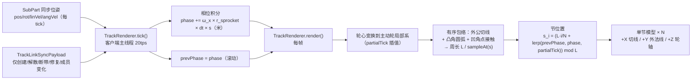

# 履带系统：物理实现设计文档

> **状态：** 实施中（v6.5；纯物理测试、`TrackLink` / `TrackAttr`、履带列表（无名字）、`VehicleData` 序列化、生命周期、测试物品的铺设闭合流程、摩擦 / 装甲 / 张力、滚动 / 命中音效覆盖已落地；长度耐久按包络推导，客户端履带节渲染与相位动画已接入；履带控制（`TrackControllerSubsystem`，设计见 [控制与驱动子系统设计](../计划中/履带系统-控制与驱动子系统设计.md)）未实现；单节模型 / 贴图资产未提供，当前用程序化几何占位）
> **日期：** 2026-10-19
> **修订记录：**
>
> - v1 — 汇总前期讨论结论：星形 GearJoint 角速度耦合方案、btGearConstraint 源码语义考证、符号约定、装配模型
> - v2 — 决议开放问题：SubPart 持有 TrackLink 反向引用，损毁/拆卸时禁用约束（非移除）；有效轮数 < 2 或主动轮失效则整条履带掉落；弃用裙板 hitbox；TrackLink 统一摩擦覆盖与装甲层（耐久/材料/厚度），履带存活期间命中优先扣减履带耐久
> - v3 — 修正装配模型：履带**不作为 Part**；履带为独立物品（非 PartItem），`TrackLink` 为 VehicleCore 级关系+状态对象（VehicleCore 持有履带列表）；成员轮子为常规 SubPart、归属既有 Part；掉落仅解散 TrackLink 并归还履带物品，轮子留在原处
> - v4 — 审阅修订：已知崩溃定性为"运动学刚体接约束入世后步进"（与 `addJoint` 的加入顺序无关）；GearJoint 轴为 body-local 且自动跟随刚体姿态（无需运行时更新轴）；有效成员计数含主动轮；成员归属变化（销毁/拆卸/分裂）统一走 TrackLink 刷新方法；TrackAttr 装甲字段集 = MaterialAttr.armor() 且不绑定子系统；trackLinks 序列化恒为列表（可空）
> - v5 — 新增第 8 章"渲染实现"（从 7.3 登记中独立出来）：包络线 + 固定数量履带节均匀排列；全部客户端本地计算（零新增同步）；节数 N 由周长/每节长推导且装配期固定；带速相位双值插值（prevPhase/phase）由 TrackRenderer.tick 积分；履带节用 Blockbench 单节模型
> - v5.1 — 审阅修订（8.3）：共线退化**不能**兜底为胶囊体（"两端半圆 + 两条直线"仅在等半径下成立，半径不同时公切线倾斜、圆弧段小于半圆）；改为凸包算法**保留共线点**，共线/非共线统一走一般化外公切线流程；补充外切线取外侧、轮间无重叠/包含假设
> - v5.2 — 审阅修订（5.3 扩展为"摩擦与音效覆盖"）：履带音效复用同一查询入口（subPart.trackLink + isWheelSurface）做替换语义——`roll` 滚动音效替换 `getTireRollSound`（初版单音效，不按地面材质细分），命中音效随 7.2 伤害路由替换 HitBox 材质；clank 节拍声（频率 = v_belt/linkLength）初版不做，后续事件节流加入；TrackAttr 增加 `sounds`
> - v5.3 — 审阅修订（4.3/7.3）：负重轮悬挂与 GearJoint **约束层面正交解耦**（平动 vs 旋转约束行、GearJoint 不关心轮心位置）；正交成立前提写入装配配置规范——悬挂走平动轴、禁止滚动轴弹簧（旋转悬挂初版不支持）、连接器锚点过轮心；载荷→阻力→负载为预期行为。7.3 该待议项关闭
> - v5.4 — 审阅修订（4.3）：撤掉"禁止滚动轴弹簧"的绝对表述——**摇臂悬挂可用多个 SubPart 组合实现且不影响履带**（摆臂↔车体连接器 A 的 X 轴配旋转弹簧、负重轮↔摆臂连接器 B 的 X 轴放行滚动；GearJoint 轴 body-local 自动跟随姿态，只约束自转角速度）。原则改为：滚动自由度 GearJoint 独占、悬挂自由度落其他刚体；支撑锚点在轮轴
> - v5.5 — 张力：新增 §4.4「相邻轮弹簧-阻尼力」——单边、只拉不推、仅链上相邻对、力钳制、轮心施力不产生扭矩；`TrackAttr` 增加 `tension` 字段；§2.2 方案表补 D，§6 补运行时结构与序列化边界，§7.1/§7.2 补成员失效与断带时的处理，§9 补实施阶段
> - v5.6 — 铺设流程：履带物品改为「右键主动轮开始 → 依次右键各负重轮 → 再次右键主动轮闭合」，闭合前草稿只存在于服务端交互层，不创建 `TrackLink`；一条履带由一次铺设产生，左右履带各铺一次，物品不按车体局部坐标分侧。张力对只覆盖铺设顺序中的相邻成员（回程段不建模，与 §4.4 一致）
> - v5.7 — 数据模型：`VehicleCore.trackLinks` 由 `Map<String, TrackLink>` 改为 `CopyOnWriteArrayList<TrackLink>`，运行时不再有履带名；`TrackLink.name` 与 `TrackLinkData.name` 删除，闭合时不再生成 `track_N`。旧存档 JSON 中多余的 `name` 字段被 Codec 忽略
> - v5.8 — 撤回 `CarControllerSubsystem` 的履带回退：删除履带载具判定、内侧轮附加制动与履带模式下的转向归零，三条轮控信号路径恢复为只叠加漂移制动偏置。履带控制改由独立的 `TrackControllerSubsystem` 承担，当前尚未实现
> - v5.9 — 渲染与耐久决议：包络以主动轮刚体坐标系为基准，测试阶段轮心取 SubPart 质心；包络改用圆盘凸包（v1 采样近似），不再用圆心凸包；`TrackAttr` 删除固定 `durability`，改为 `link_durability` + `link_length`，最大耐久 = `link_durability × N`，N 由包络总长推导；相位改用主动轮相对车体的体坐标 X 角速度（对齐 `WheelDriverSubsystem#getRelativeAngularVel`），不采用 pitch；`TrackLink` 仅在创建 / 解散 / 断带 / 修复 / 成员变化时同步，不再按每次伤害全量同步；单节模型与贴图测试阶段硬编码，内容包未接
> - v6.0 — 非凸包络：包络改为按 `TrackLink.members` 顺序的闭合带路，不再对圆盘集合取凸包；凸角（主动轮、诱导轮、比两侧低的负重轮）走外公切线 + 圆弧，凹角 / 共线（被障碍抬起的负重轮、平地负重轮）走单点接触，接触点为轮子外侧角平分线与圆的交点。抬轮时履带贴住该轮，不再从它下面跨过去；凸布局下带路与凸包重合。服务端 `N` / 最大耐久改用同一有序带路，原型 5 场景 / 99 断言通过
> - v6.1 — Java 几何落地：`util/geometry/` 新增 `Vec2`、`Circle2D`、`ConvexHull2D`、`BeltPath2D`；`BeltPath2DTest` 15 个纯 JUnit 用例通过（凸/平/抬/降、2 轮 stadium/不等半径/包含、顺时针归一化、弧长采样、圆弧终点、无自交、不切入轮子、非法输入、凸包基线）。
> - v6.2 — 接入游戏：`TrackAttr` 改为 `link_durability` / `link_length`；`TrackLink` 由 `TrackEnvelope2D` 推导 N 与最大耐久，普通伤害不逐发同步；新增 `TrackRenderer` 的程序化履带节、主动轮 X 角速度相位与 `AFTER_ENTITIES` 渲染；`BeltPath2D` 增加共线凸包回退；`BeltPath2DTest` 扩到 16 个用例，全量 29 个 JUnit 通过
> - v6.3 — 锚定顺序：3 轮及以上不再按轮心多边形绕向反转输入；绕行方向由“闭合边之外最低的一条下行程边”的外法线朝下确定，主动轮与最后一个上行程轮固定为端帽圆弧。凹角支撑点仍取外侧角平分线，但圆弧方向改为按“离心几何中心最远的一侧”在 ±2π 两支中选取，端帽包角可以超过半圈。`TrackEnvelope2D` 先把成员旋转到主动轮首位；轮心全共线或轮组实际重叠时回退凸包，其余几何失败返回 null。被顶起的下行程轮如果高过回程闭合边，构建器把同一轮追加到序列末尾：下行程轮底点接触、回程轮顶圆弧，同一 `wheelIndex` 出现两次。相位按下行程切线的 +Z/−Z 符号对齐。新增三角形 / 抬起中间轮（二次接触）/ 同一轮心两种锚定顺序 / 近共线内部端帽 4 个用例，`BeltPath2DTest` 21 个、全量 34 个 JUnit 通过
> - v6.4 — 端帽判定改为按转角绝对值：`|转角| > 3π/4` 的顶点一律凸角，不依赖绕行方向。近共线轮序里端帽转角是 ±π，`s × 转角` 的符号只由轮心落在共线的哪一侧决定，微小位姿噪声就会让包络在“绕过该轮”与“擦过半径上一点、轮心留在环外”之间跳变。JS 原型同步到与 `BeltPath2D` 同一套规则（锚定顺序、绕行符号、端帽、弧向选择、回程二次接触、割线校验、2 轮、凸包回退），`node track-path-tests.js` 7 场景 / 17 用例 / 270 断言通过；`BeltPath2DTest` 的端帽用例改为退化轮序下扫过四个末轮高度的稳定性断言，21 个用例、全量 34 个 JUnit 通过
> - v6.5 — 全轮组有向接触求解：成员顺序与动态接触表分开，所有跨段通过切线可见图避让；点接触 / 圆弧由实际进出线与半径决定。铺设绕向随存档和蓝图保存，主动轮自转、共线与整体翻转不重判方向；相位和履带节基底按闭环绕向取符号。JS 对照同步，Java 全量 55 个测试、JS 7 场景 / 18 用例 / 321 断言通过。

***

## 1. 背景与动机

### 1.1 现状：轮式驱动管线

Machine-Max（NeoForge 1.21.1）是数据驱动的载具组装模组。载具拓扑为三层：

```
VehicleCore（聚合根，partNet 图）
  └── Part（部件容器，可共享耐久度）
        └── SubPart（零件实体，每个 SubPart 一个 Bullet 刚体，Spark-Core 集成）
```

- **物理引擎**：Spark-Core 1.0.1031 内嵌 LibbulletJME（jMonkeyEngine 的 Bullet 封装，native 侧为 Bullet 3，源码位于 `Libbulletjme/src/main/native/bullet3/`）。
- **连接器**：`AbstractConnector`（成对概念），关节为 `New6Dof`，默认 6 轴全锁（`adjustJoint`）；`AdvancedConnector` 支持每轴弹簧/阻尼/限位。
- **轮式驱动链**：`Engine/Motor`（IMechPowerProducer）→ `Gearbox` → `Transmission`（多输出、开放差速/差速锁、每输出独立减速比）→ `WheelDriverSubsystem` → 轮子连接器关节的滚动轴 `RotationMotor`（RotationOrder.XZY，0 轴=滚动，1 轴=转向伺服）。
- **接地摩擦**：`CollisionHandler.setupFriction` 按接触部位所属 HitBox 材质逐接触设置 `friction`/`rollingFriction`/`spinningFriction`/`restitution`；轮面接触由 `SubPart.isWheelSurface()`/`getWheelRadius()` 判定，配合滑移曲线（`DynamicUtil.calculateSlipScale`）计算驱动力。
- **线程模型**：主线程（20tps）与物理线程（Bullet 步进）分离；物理体操作必须经 `getPhysicsLevel().submitImmediateTask(PPhase...)`。
- **同步模型**：每个 SubPart 每 tick 经 `SynchedEntityData` 同步 pos/rot/linVel/angVel（`DestroyableRigidObject.postTick`）；客户端刚体为运动学模式（`SubPart` 构造器 `setKinematic(true)`），只吃服务端同步位姿；**关节仅在服务端加入物理世界**（`AbstractConnector.addToLevel`）。

目前仅支持轮式载具，尚无履带。

### 1.2 需求与范围

| 需求 | 说明                          |
| -- | --------------------------- |
| 驱动 | 主动轮（sprocket）输出扭矩，经"履带"驱动整车 |
| 承重 | 负重轮组承载车重、接地滚动               |
| 转向 | 双履带差速转向（skid steer）         |
| 组装 | 履带以独立物品形式存在，玩家无需逐个安装负重轮     |

**范围界定**：本文档讨论**物理实现**、**张力近似**（4.4）、**渲染实现**（第 8 章）与**音效覆盖**（5.3）。

**约束**：不得破坏现有组装模型（连接器对偶、partNet 拓扑、耐久度传递）；必须遵循线程/同步纪律；规避已知崩溃（见 3.3）。

***

## 2. 方案总览与关键决策

### 2.1 核心思路

履带 = **1 个主动轮 + N 个负重轮**，全部为独立 SubPart 刚体（复用轮式管线的碰撞、摩擦、同步设施），通过 **btGearConstraint（LibbulletJME** **`GearJoint`）** 做角速度耦合：

```
v_belt = ω_sprocket × r_sprocket = ω_road_i × r_road_i
   ⇒  ω_road_i = ω_sprocket × r_sprocket / r_road_i
```

即"多轮按半径比同步角速度"近似履带带速守恒。

- **拓扑为星形**：每个负重轮分别与主动轮建立一条 GearJoint。装配 UX 是「右键主动轮开始 → 依次右键各负重轮 → 再次右键主动轮闭合」；首个选中的轮就是主动轮，但运行时约束是星形而非链式（理由见 4.1）。
- 传动比为静态（轮半径静态），装配时自动推导，无需手配。
- **TrackLink 还承担四类非约束职责**：整条履带的耐久度（装甲层）、接地摩擦（覆盖成员轮子的材质摩擦）、断带/掉落状态机、张力近似（相邻轮弹簧-阻尼力，见 4.4）。

### 2.2 方案对比与决策记录

| 方案                        | 描述                               | 结论                      |
| ------------------------- | -------------------------------- | ----------------------- |
| **A. GearJoint 星形耦合（选定）** | btGearConstraint 速度行耦合角速度        | 采用。求解器内双边速度行，动量交换，无额外同步 |
| B. 软耦合（代码修正力矩）            | prePhysicsTick 施加限幅纠偏力矩          | 备选。仅当需要"皮带滑移柔量"时采用      |
| C. 单刚体履带                  | 整条履带 = 1 个 SubPart + 复合碰撞形状，直接施扭 | 备选。内容包级低配降级路径，同步量最小     |
| **D. 相邻轮弹簧-阻尼力（选定，张力近似）** | 物理步对链上相邻成员施加单边弹簧-阻尼力 | 采用。与 A 配合：A 管角速度，D 管平移；只表达"带兜住轮组、顶起一轮带动邻轮"，不做带长守恒（4.4） |

**决策记录（含前期的错误类比更正）**：

1. 早期曾以"`MotorSubsystem.coupleTorque` 停车振荡"反对硬约束。**该类比不成立，已撤回**：`coupleTorque` 是 `onPrePhysicsTick` 中 PD 控制器施加于引擎标量转速 ODE 的修正力矩（控制回路问题：无死区、无饱和的 PD 在停车点 hunting）；btGearConstraint 是**求解器内迭代求解的双边速度行**，做的是两刚体间的角动量交换。二者机制不同，失败模式不可迁移。
2. GearJoint 的真实代价是**无限刚度皮带**（负重轮与主动轮之间零滑移柔量）。对履带而言，"锁死主动轮 → 全组锁死"是真实履带的保真行为（锁链滑移），不是缺陷。若后续需要"负重轮可相对带速滑移"（打滑柔量），再引入方案 B。
3. 服务端单边物理（客户端关节不求解）是既有架构的既定模式（连接器关节本就如此），不构成问题。
4. 方案 C 在"密集件量/同步压力优先"时更优，但与方案 A 共用同一套 JSON 声明面，可作为内容包级变体。
5. 张力采用方案 D 的力近似，不采用轮间距离约束或全局带长约束：后者会与悬挂连接器形成闭环、在无 warm starting 的关节求解下易抖动，且距离上限约束需要 native 支持。本项目以"物理可信"为目标，只需要可感知的连带抬升效果，不需要带长守恒。

### 2.3 装配模型：履带不作为 Part

- 履带**不是 Part**：成员轮子（主动轮/负重轮）是普通 SubPart，归属其所在的常规 Part（如车体、悬挂件），连接器/耐久度/同步走既有管线，**所有权完全不变**。
- 履带以**独立物品**形式存在（**非 PartItem**），作用于整辆载具：一次铺设闭合时在 `VehicleCore` 中注册一个 `TrackLink`；**VehicleCore 持有履带列表**（如 `List<TrackLink>`）。
- `TrackLink` 是纯**关系 + 状态**对象：成员引用（SubPart）、GearJoint 组、履带耐久/装甲/摩擦、断带状态。成员可来自载具的任意 Part（同一装配上下文即可）。
- 履带掉落/解散只意味着 TrackLink 销毁 + 履带物品归还掉落，**轮子 SubPart 留在原 Part 上**（自由滚）。
- 存档：TrackLink 状态随 `VehicleData` 序列化（成员标识 + 耐久/断带），GearJoint 与反向引用为运行时对象，加载时重建。

***

## 3. btGearConstraint 的代码层语义（源码考证）

> 结论均有代码支撑，路径引用以本机源码树为准：
>
> - Java 侧：`Spark-Core/src/main/java/com/jme3/bullet/joints/GearJoint.java`（jMonkeyEngine 2022-2023 版权，Spark-Core 内嵌副本）
> - C++ 侧：`Libbulletjme/src/main/native/bullet3/BulletDynamics/ConstraintSolver/btGearConstraint.cpp/.h`
> - 求解器：同目录 `btSequentialImpulseConstraintSolver.cpp`

### 3.1 行构造

```cpp
void btGearConstraint::getInfo1(btConstraintInfo1* info) {
    info->m_numConstraintRows = 1;
    info->nub = 1;
}

void btGearConstraint::getInfo2(btConstraintInfo2* info) {
    globalAxisA = m_rbA.getWorldTransform().getBasis() * m_axisInA;
    globalAxisB = m_rbB.getWorldTransform().getBasis() * m_axisInB;
    info->m_J1angularAxis = globalAxisA;            // J1 = a_A（世界系）
    info->m_J2angularAxis = m_ratio * globalAxisB;  // J2 = ratio·a_B（世界系）
    // 不写 m_rhs（约束误差），不写 limit
}
```

求解器侧 `convertJoint` 将该行初始化为 `lowerLimit = -INF`、`upperLimit = +INF`，RHS 保持 0。因此这是**单条双边速度行**：

```
ω_A · a_A + ratio · (ω_B · a_B) = 0
```

- **纯速度约束**：无位置误差项 → 轮相位漂移无界。对履带无物理意义（只有带速守恒有意义），可接受。
- **无能量注入**：双边速度行按冲量公式交换两刚体角动量，能量中性。

### 3.2 求解器行为

- 该行属于 `m_tmpSolverNonContactConstraintPool`，**参与每次 solver iteration**（与接触行同批迭代）。
- **无 warm starting**：`convertJoint` 每帧 `m_appliedImpulse = 0.f` 清零；warm start 仅发生在接触行（从 manifold 缓存读取 `cp.m_appliedImpulse × warmstartingFactor`）。
- 双运动学体保护：`jacDiagABInv` 计算有除零保护（`fsum > SIMD_EPSILON ? sorRelaxation/sum : 0.f`），不会 NaN。

### 3.3 对本项目的含义（纪律要求）

1. **仅服务端入世界**：btGearConstraint 要求至少一个刚体为动力学模式；客户端刚体全 kinematic。沿用连接器关节的既有惯例（服务端才 `addJoint`）。
2. **已知崩溃纪律**（已定位根因，证据见 [`docs/plan/计划中/物理-运动学刚体接约束入世后步进崩溃.md`](../计划中/物理-运动学刚体接约束入世后步进崩溃.md)）：
   - **不要用运动学模式冻结参与关节的刚体**：关节两端都是运动学刚体时，多线程构建下一次步进即崩——岛屿构建按定义跳过静态/运动学体并把它们的 island tag 写成 `-1`，于是 `btGetConstraintIslandId1()` 返回 `-1`，而 `btSimulationIslandManagerMt::addConstraintsToIslands` 在 release 下无保护地用它索引岛查找表（元素 8 字节 → 故障地址 `-8`）。单线程构建不编译该管理器，因此不崩。
   - 履带 GearJoint 的两刚体在服务端均为**动力学**模式（客户端 kinematic 且关节不入世界），不触发该崩溃。
   - 禁止以运动学模式制动刚体，使用 `speedFactor`；需要把刚体钉在原地时用平动/转动系数归零（刚体保持动态，照常参与岛屿构建）。
   - **约束加入世界时两端刚体应当已在碰撞世界中**，移出刚体前应先摘掉引用它的约束——本项为纪律要求，其机制说明与未闭合的边界见 `docs/plan/计划中/物理-运动学刚体接约束入世后步进崩溃.md` §2.3。
   - GearJoint 的增删同样必须走 `submitImmediateTask(PPhase.PRE/ALL)`。
3. 无新增同步：耦合是纯服务端计算，负重轮旋转经既有 SubPart 位姿同步到达客户端。

***

## 4. 约束拓扑与传动比

### 4.1 星形拓扑、铺设闭合 UX

- **装配标记**（蓝图声明或物品使用阶段）：在载具上右键主动轮开始铺设，然后**先点下行程的全部轮（含被顶起的负重轮），再点上行程轮（诱导轮 / 托带轮）**，最后再次右键主动轮闭合。**第 1 个选中的轮 = 主动轮**；点击顺序同时是包络的锚定绕行顺序与张力对顺序。顺序错误时包络会按错误方向绕行，交互层需要用高亮或提示约束这个顺序。
- **一条履带由一次铺设产生**：物品不按车体局部坐标分侧，左、右两条履带各做一次独立铺设；闭合前不创建 `TrackLink`，因此多次铺设不会误并入同一条履带。
- **运行时约束**：生成 N 条 GearJoint（主动轮 → 每个负重轮），星形。

| 拓扑 | 约束数 | 稳态等价性 | 有限迭代收敛           | 单轮损毁鲁棒性      |
| -- | --- | ----- | ---------------- | ------------ |
| 星形 | N   | 等价    | 各轮独立对主动轮，误差不沿链累积 | 移除损毁轮约束不影响其余 |
| 链式 | N   | 等价    | 误差沿链逐级累积，末端略差    | 中间轮断开会把链拆成两段 |

星形在收敛与损毁隔离上都更优，约束数相同，故选星形。

- **成员约束**：成员为载具内既有 SubPart，可来自不同 Part（同一装配上下文，TrackLink 为 VehicleCore 级）；半径从 `SubPart.getWheelRadius()`（attr 现有轮半径表）读取。

### 4.2 传动比与符号约定（关键陷阱）

带速守恒给出比值大小：

```
|ratio| = r_road / r_sprocket      （A = 主动轮，B = 负重轮）
```

代入行语义 `ω_A·a_A + ratio·(ω_B·a_B) = 0`：两轴同向（都取轮体局部 +X）时，同向滚动要求两端投影同号，故 **ratio 必须为负**：

```java
new GearJoint(sprocketBody, roadBody,
              Vector3f.UNIT_X, Vector3f.UNIT_X,
              -(r_road / r_sprocket));   // 符号不能丢
```

或等价地保持 ratio 为正、将 B 端轴反向。二选一；符号写反的表现为两轮反向拉扯、接地啸叫、动力抵消。

半径静态 → ratio 静态，装配时一次推导即可（`setRatio` 也可运行时修改，预留半径变体）。

### 4.3 轴对齐与连接器自由度

- GearJoint 的轴为 **body-local（相对刚体局部系）**：构造参数 `axisInA/axisInB` 取刚体局部坐标；native `getInfo2` 每帧以 `m_rbA.getWorldTransform().getBasis() × axisInA` 转世界系——**轴自动跟随刚体姿态**，负重轮悬挂引起的姿态变化无需运行时更新轴（`setAxisA/B` 仅用于装配期修正）。
- 全项目约定：所有轮胎滚动轴 = 轮体局部 +X（与 WheelDriver 的 XZY 序 0 轴、blockbench x+ 朝右约定同源）。装配时一次推导 ratio 与 axis；阶段 1 验证马达驱动轴（关节帧 X）与 GearJoint 读取轴（body-local X）在世界系对齐（轮式载具能正常驱动即隐含满足）。
- **负重轮连接器必须放行滚动轴**：`AbstractConnector.adjustJoint` 默认 6 轴全锁（LowerLimit/UpperLimit = 0），负重轮所属 Part 的连接器 JSON（`JointAttr`）需把滚动轴配为自由（无上下限、无弹簧），否则连接器关节与 GearJoint 在同一自由度上冲突。
- **悬挂与 GearJoint 正交（v5.3/v5.4 决议，约束层面无相互作用）**：GearJoint 只耦合角速度、不关心轮心位置，悬挂行程不影响带速守恒（`ω·r` 不变）；其轴为 body-local、自动跟随刚体姿态，支撑结构的摆动不影响自转角速度耦合。核心原则：**负重轮自身的滚动自由度必须纯放行（GearJoint 独占）；悬挂自由度必须落在"其他刚体"上**，两种悬挂均满足：
  1. **平动悬挂**：负重轮直接连车体，连接器**平动轴**（Y）配弹簧/阻尼，滚动轴（X 旋转）放行。
  2. **摇臂悬挂（旋转弹簧）**：摆臂作**独立 SubPart**——摆臂↔车体连接器 A 的 X 轴配弹簧/阻尼（悬挂、限位），负重轮↔摆臂连接器 B 的 X 轴放行（滚动）。旋转弹簧作用在摆臂刚体、滚动在负重轮刚体，自由度分离，不影响 GearJoint。
  - **装配规范**：负重轮与支撑之间的连接器锚点应位于**轮轴**上，避免偏置力矩干扰自转（多轮拉扯）。
  - 悬挂压缩 → 接地载荷变化 → 各轮接触阻力变化 → GearJoint 汇入主动轮负载，属**动力学预期行为**，无需处理。
- **WheelDriver 仅装在主动轮**的连接器上；其马达目标速度的方向、符号必须与 GearJoint 一致，避免马达与齿轮行互相拉扯。

### 4.4 张力的近似模型（相邻轮弹簧-阻尼力）

**定位**：目标是让玩家感知到"带把轮组兜住、一个轮被顶起会带动相邻轮"，不求解整圈带长守恒。模型只在相邻成员之间施加单边弹簧-阻尼力，是纯力层实现：不建约束、不形成闭环、不需要 native 支持。

**成对范围：**

- 成员序列按装配时的选择顺序排列（首个为主动轮，随后是下行程、上行程），张力对 = 序列中相邻的两项 `(i, i+1)`。
- 仅相邻对，不做全连接；序列末端与主动轮之间不生成对（回程段不建模）。
- 与 GearJoint 的星形拓扑相互独立：星形负责角速度耦合，相邻对负责平移耦合。

**力模型：**

```
n = normalize(pB − pA)
d = |pB − pA|
stretch = d − (rest − preload + slack)
vSep = (vB − vA) · n          // > 0 表示两轮正在分离

T = 0
若 stretch > 0 且履带未断带：
    T = clamp(k · stretch + c · max(vSep, 0), 0, maxForce)

F_A += T · n
F_B −= T · n
```

- **单边**：`d ≤ rest − preload + slack` 时 `T = 0`，压缩段与松弛段都不推轮。
- **阻尼只作用于分离速度**：`vSep ≤ 0` 时阻尼项为零，回弹过程只受弹簧力。
- **施力点在轮心**：`applyCentralForce` 不产生扭矩，轮的自转仍由 GearJoint 负责，平移与旋转互不重复计算。
- **相位**：服务端物理线程 `PPhase.PRE`，每个 substep 用刚体当前位置/速度重算；Bullet 每步结束清除外力。
- **`rest`**：装配或载入时按相邻轮心距采样，是运行时量，不写入 `VehicleData`。
- **`preload`**：把基准长度虚拟缩短的量，使带在静止状态保有预紧；默认 0，需要"起步前就绷住"的效果时再调大。
- **`slack`**：`rest` 之上的自由伸长量，悬挂正常回弹在该范围内不触发张力。
- **`maxForce`**：每对张力的硬上限。参考取值为整车重量的 5%~10%；超过该量级会明显压缩悬挂的独立行程，履带接近刚性框架。

**参数与量级：**

| 参数 | 单位 | 说明 |
| -- | -- | -- |
| `stiffness`（k） | N/m | 1 吨级载具从 `1e4` 量级起调；数值决定过坎时邻轮跟随的明显程度 |
| `damping`（c） | N·s/m | 取 `2ζ√(k·m_eff)`，`ζ≈0.5~1` |
| `preload` | m | 虚拟缩短基准长度形成的预紧，默认 `0` |
| `slack` | m | `rest` 之上的自由伸长量，典型 `0.01~0.02` |
| `maxForce` | N | 每对张力的硬上限 |

显式积分在 60 Hz 下对上述量级稳定（`k·dt²/m_eff ≪ 1`）；风险来自力过大导致悬挂僵硬，而不是数值发散。

**能表达与不能表达：**

| 能 | 不能 |
| -- | -- |
| 一个轮被障碍顶起时，相邻轮沿连线被带起、被顶起的轮被拉回 | 整圈带长守恒：所有对同时拉长时没有全局回正 |
| 起步/停车时轮组的绷紧感 | 上带段与回程段的下垂 |
| 断带后张力消失 | 主动轮与诱导轮之间的张力差、真实链节动力学 |
| 损毁/分裂后按成员表跳过失效对 | 切线方向的精确受力（使用轮心连线近似） |

**失效处理：**

- `refreshMembers()` 重建有序成员表与相邻对；任一端失效的对直接跳过，不施力。
- 断带（`broken`）时 `T` 恒为 0，轮组自由滚，与 §7.2 的断带状态共用同一状态位。

***

## 5. 与既有管线的集成

### 5.1 动力链

```
Engine/Motor → Gearbox → Transmission → WheelDriver（主动轮连接器滚动轴）
                                          │
                                          └─ GearJoint×N ── 负重轮组
```

齿轮行把负重轮动量耦合进主动轮负载：负重轮接地阻力 → 主动轮转速下降 → `WheelDriver.getFeedbackSpeed()` → 上游反馈回路 → 引擎加扭。能量自动回流，无需特殊记账。

### 5.2 差速转向

- 左/右主动轮各一个 `WheelDriverSubsystem`；`TransmissionSubsystem` 双输出驱动（已有每输出减速比、开放差速/差速锁能力，`diffLock` 可模拟"闭锁转向"）。
- 履带控制由独立的 `TrackControllerSubsystem` 承担（不复用 `CarControllerSubsystem` 的轮式控制）：`MoveInputSignal → 左侧 = 油门 + 转向偏置，右侧 = 油门 − 转向偏置`，输出两个 `WheelControlSignal`。
- `VehicleCore.ControlMode` 增加 `TRACK` 枚举值。

### 5.3 摩擦与音效覆盖（v5.2 扩展）

- 沿用 `CollisionHandler`：轮面接触判定（`isWheelSurface`）+ 滑移曲线（`calculateSlipScale`）。
- **履带组接触的摩擦以 TrackLink 为准**：接触属于履带成员且为轮面时，`setupFriction` 用 TrackAttr 的摩擦参数**替换** HitBox 材质参数（`replace` 语义）。查询入口即 `subPart.trackLink` 反向引用，无需额外注册表。
- **不引入履带裙板 hitbox**（已决议）：连续接地面由负重轮组近似，不添加无驱动碰撞体。由此 `anisotropicFriction` 的 body 级状态竞争问题自然消失——每个 SubPart 只属于一条履带，同一刚体上所有履带接触的摩擦值一致，不会互相覆盖。
- 负重轮自身 HitBox 的 `rollingFriction` 建议配 0（滚动速度由带速耦合决定），履带组滚阻由 TrackAttr 统一声明。
- **履带音效覆盖（v5.2 决议）**：音效与摩擦同源，复用同一查询入口（`subPart.trackLink` + `isWheelSurface`），在既有两条音效管线上做**替换**语义：
  - **滚动持续音效**：`CollisionEffectManager.getFrictionSound` 在接触属于履带成员且为轮面时返回 TrackAttr 的 `roll` 音效（替换 `getTireRollSound` 的橡胶声，改用金属履带声）；淡入淡出、材质切换、速度驱动音量/音高的既有机制不变。
  - **命中音效**：履带装甲层吸收命中（见 7.2 伤害路由）时，用 TrackAttr 的 `hit_un_pen`/`hit_pen`（替换 `HitBox.getHitPenSound`/`getHitUnPenSound` 的 HitBox 材质音效）。
  - 初版 `roll` 为**单个音效**（履带声以金属板为主，地面材质差异弱于轮胎）；后续如需按地面材质细分，将 `roll` 扩展为 map。
  - **履带节拍击声（clank，频率 = v_belt/link_length）**：最具辨识度但事件频率高（每秒 3\~8 次），初版**不做**，后续以事件节流方式加入。

### 5.4 线程与同步

- GearJoint 仅服务端；客户端负重轮 kinematic，吃服务端同步位姿（既有 SubPart 同步管线，零新增同步流量）。
- 张力近似（4.4）同样仅在服务端物理线程计算与施力；客户端不施加张力、不做带长求解，效果经既有位姿同步呈现。
- 生命周期遵循连接器关节同款纪律（顺序 addToLevel、submitImmediateTask 增删）。

***

## 6. 数据与序列化（框架草案）

### 6.1 履带物品/蓝图声明（草案）

- **履带物品**（非 PartItem）携带 TrackAttr 属性模板：

```json
{
  "link_durability": 20.0,
  "link_length": 0.2,
  "min_effective_wheels": 2,
  "armor": {
    "rha": 30.0,
    "angle_effect": true,
    "decay_rha": 0.5,
    "unpen_power": 0.6,
    "modifiers": { }
  },
  "friction": {
    "anisotropic": [0.9, 0.9, 1.0],
    "rolling": 0.05,
    "spinning": 0.0,
    "restitution": 0.0
  },
  "tension": {
    "enabled": true,
    "stiffness": 12000.0,
    "damping": 900.0,
    "preload": 0.0,
    "slack": 0.015,
    "max_force": 800.0
  },
  "sounds": {
    "roll": "part.track.roll",
    "hit_un_pen": "part.track.hit_up_pen",
    "hit_pen": "part.track.hit_pen"
  }
}
```

- `link_durability`：**每节耐久**。履带最大耐久由包络总长决定：`N = max(1, round(L / link_length))`，`max_durability = link_durability × N`。不声明整条带的固定血量。
- `link_length`：**每节长度（米）**，同时用于节数推导与最大耐久推导；必须大于 0。
- `sounds`：履带音效覆盖（见 5.3）——`roll` 为滚动持续音效（替换 `getTireRollSound`）；`hit_un_pen`/`hit_pen` 为命中音效（替换 HitBox 材质，随 7.2 伤害路由生效）。
- `tension`：张力近似的弹簧-阻尼参数（见 4.4）。`stiffness` 单位 N/m、`damping` 单位 N·s/m、`preload`/`slack` 单位米、`max_force` 单位 N；`enabled=false` 时整条带不施加张力力。`rest` 不声明，装配/载入时由相邻轮心距采样。

- **成员绑定**：运行时由玩家铺设闭合（物品使用流程），或蓝图静态声明：

```json
{
  "sprocket": "drive_sprocket",
  "road_wheels": ["road_1", "road_2", "road_3", "road_4", "road_5", "road_6"]
}
```

- `sprocket`：铺设起始的主动轮 SubPart 名。
- 物品应用流程：手持履带物品右键主动轮开始，依次右键各负重轮，再次右键主动轮闭合 → 在 `VehicleCore.trackLinks` 注册 TrackLink。闭合前草稿只存在于服务端交互层，不参与物理、同步或存档；左、右两条履带各做一次铺设。蓝图载具由蓝图 JSON 直接声明成员名（跳过选择）。
- 传动比**不声明**，运行时由 `getWheelRadius()` 自动推导。
- `armor` 字段集复用 `HitBoxAttr` 的材质装甲定义（`MaterialAttr.armor()`：rha/angleEffect/decay_rha/unpen_power/三类 DamageModifier），**不绑定子系统**（HitBoxAttr 的 subsystem 关联对履带不适用）；无 `armor_level` 命名字段（ArmorLevel 由 RHA 推导）。
- 单节模型与贴图测试阶段**硬编码**在渲染器常量里，不进入 TrackAttr；内容包接入时再迁入。

### 6.2 运行时结构（草图）

```
VehicleCore.trackLinks: List<TrackLink>          # 履带列表（无名字；列表项本身即身份）

TrackLink（VehicleCore 级关系+状态对象：无独立刚体、无所有权）
  ├── sprocket: SubPart          # 铺设起始的主动轮（所属 Part 不变）
  ├── members: List<SubPart>     # 有序成员表（首个为主动轮），相邻两项构成 4.4 的张力对
  ├── roadWheels: List<RoadWheel># 有序（装配顺序）
  │     └── { subPart, gearJoint, ratio, enabled }
  ├── tensionPairs: List<Pair>   # { a, b, rest }；rest 为装配/载入时采样的轮心距（运行时）
  ├── linkCount / maxDurability  # N = max(1, round(L / link_length))；max = N × link_durability（包络总长推导）
  ├── durability / broken        # 当前耐久与断带状态（累加器模式更新，主线程处理）
  ├── armor / friction           # TrackAttr 装甲层与接地摩擦
  ├── tension: TensionParams     # TrackAttr 的 k/c/preload/slack/maxForce（4.4）
  └── item 标识                  # 对应履带物品（解散时归还掉落）

SubPart.trackLink: TrackLink     # 反向引用（可空）。装配接线写入；
                                 # 销毁/摩擦/伤害三条路径共用这一个查询入口
```

- 生命周期：统一由 `refreshMembers()` 驱动（销毁路径 → `SubPart.destroy()` 入口回调；拆卸/分裂路径 → `VehicleCore` 结构变更后调用，见 7.1），先禁用失效成员的 GearJoint、重建有序成员表与张力对（4.4），再计数决定是否解散整条履带。
- 存档：TrackLink 随 `VehicleData` 序列化（成员 SubPart 标识 + 当前 `durability`/`broken`）；`durability` 是绝对当前值，最大耐久在加载后由包络总长重新推导。蓝图 / 收纳用 `durability = -1` 作为“满耐久”哨兵，`TrackLink.fromData` 解析出 `N` 后落到 `maxDurability`。GearJoint、`SubPart.trackLink` 反向引用、张力对的 `rest` 为运行时对象，加载时在部件与连接关系重建**之后**按成员标识重建，`rest` 在重建后按当前轮心距采样。
- `VehicleData.trackLinks` 恒为列表（可为空）：JSON Codec 用 `TrackLinkData.CODEC.listOf().optionalFieldOf("track_links", List.of())`，STREAM_CODEC 直接 `writeCollection` 编码列表长度；空列表不影响网络传输。

***

## 7. 损毁/拆卸与装甲层（已决议）

### 7.1 SubPart 损毁/被拆卸

**机制：禁用约束，而非移除。**

- `Constraint.setEnabled(false)` 直通 native `btTypedConstraint::setEnabled`，GearJoint 直接继承。
- 求解器对禁用约束**完全跳过**：`btSequentialImpulseConstraintSolver.cpp` 行 1320-1328，`!isEnabled()` 时 `m_numConstraintRows = 0`，不构造行、不查刚体。因此**禁用约束即使其刚体已移出世界也绝对安全**，无需 remove/add 的线程顺序纪律与 native 重建，恢复时可逆（重新 `setEnabled(true)`）。
- **顺序要求**：必须在成员刚体移出世界**之前**禁用。`SubPart.destroy()` 入口先调 `trackLink.onMemberDestroyed(this)`（内部经 `submitImmediateTask(PPhase.PRE)` 执行 `setEnabled(false)`），再走既有销毁流程。
- **反向引用**：`SubPart` 增加可空字段 `trackLink`，装配接线时写入；销毁、摩擦、伤害三条路径共用这一个查询入口，无需 VehicleCore 扫描。
- 单轮拆卸：v1 维持内部连接器 `internal` 语义（玩家不可单独拆轮），摧毁路径不受限。

**整条履带掉落规则：**

- 有效成员 = 未摧毁的 SubPart 成员（**计数含主动轮**）。
- **主动轮失效，或有效成员总数（含主动轮）<** **`min_effective_wheels`（默认 2）→ TrackLink 解散，履带掉落为物品**。默认值 2 即"主动轮 + 至少 1 个负重轮"。
- 轮子 SubPart 仍属各自 Part：被摧毁的轮走普通 SubPart 销毁流程；存活的轮留在原处自由滚。
- 解散通知沿用既有拆卸通知模式（`PartRemovePayload` 类或专用 `TrackLinkSyncPayload`），无新机制。

**成员归属变化的统一入口（销毁 / 拆卸 / 分裂收敛）：**

- `TrackLink` 暴露单一刷新方法（如 `refreshMembers()`）：重算有效成员 → 对失效成员禁用对应 GearJoint（`setEnabled(false)`，经 `submitImmediateTask(PPhase.PRE)`）→ 重建有序成员表与张力对（4.4）→ 按上述规则判定是否解散。
- 销毁路径：`SubPart.destroy()` 入口调 `trackLink.onMemberDestroyed(this)`。
- 拆卸/分裂路径：`VehicleCore.detachConnections`/`removePart` 使某 Part 离开装配后，对相关 TrackLink 调 `refreshMembers()`——**成员离开装配即视为失效（即使 SubPart 未销毁）**，防止 GearJoint 跨装配体残留耦合（载具分裂后主动轮与负重轮分属两个 VehicleCore 的场景）。

**张力对的失效处理：** 张力是力层实现，不涉及约束启停。`refreshMembers()` 重建成员表后，任一端失效的对跳过施力；断带时全部张力为零。该处理与 GearJoint 的禁用相互独立。

**与"履带装甲层"的区分（两层独立规则，勿混）：**

| 层                 | 事件          | 后果                                             |
| ----------------- | ----------- | ---------------------------------------------- |
| 履带装甲耐久（TrackAttr） | 归零 = **断带** | 禁用全部 GearJoint、张力置零，轮子自由滚，TrackLink 仍在（单侧失驱/拖行），可修复 |
| 轮子 SubPart        | 摧毁 = 计数     | 有效成员 < 2 或主动轮失效 → **TrackLink 解散、履带物品掉落**      |

### 7.2 摩擦覆盖与履带装甲层

**摩擦覆盖：**

- TrackAttr 声明整组接地摩擦（`anisotropic`/`rolling`/`spinning`/`restitution`），接触属于履带成员且为轮面时**替换** HitBox 材质参数（见 5.3）。不引入裙板 hitbox。

**履带装甲层（借鉴 HitBox 思路）：**

- TrackAttr 增加 `link_durability` + `link_length` + `armor`（rha/armor\_level/跳弹/钝伤参数，字段集照搬 HitBoxAttr）+ 材质信息；最大耐久 = `link_durability × N`，`TrackAttr` 只声明每节参数，整条带的总血量由公式推导。
- **伤害路由**：带履带的 SubPart 被命中且履带未摧毁时——
  - BF 协议方法代理：`getRHA/modifyPenetration/isArmorPenetrated/resolvePenetration/calculateFinalDamage` 在履带存活期间全部以 TrackAttr 装甲层结算；
  - `hurt()` 中伤害扣减 TrackLink 耐久（累加器模式，主线程处理），跳过 SubPart 自身耐久、HitBox 子系统伤害与连接点冲击分配；
  - 履带摧毁后恢复原管线（各自受击）。
- **穿透语义 = 前置吸收层，不穿透**：BallisticsFramework 为单区结算（每次解析一个装甲区），且履带无碰撞形状（已决议不要 hitbox），因此"击穿履带后继续伤害轮子"的分层穿透不成立——命中在履带存活期间由履带吸收，履带摧毁后才轮到轮子。若未来要分层穿透，需给履带加碰撞形状，与当前决议互斥。
- **断带**：履带耐久归零 → 禁用全部 GearJoint（轮子自由滚）、张力置零（见 4.4），TrackLink 保留并进入失驱状态；焊接修复（复用 `repair` 管线，`trackLink.repair(amount)`）恢复耐久后重新启用约束与张力。
- 同步：`TrackLink` 只在创建 / 解散 / 断带 / 修复 / 成员变化时经 `TrackLinkSyncPayload` 全量同步；普通伤害只改服务端耐久，不逐发发包。客户端轮子视觉由同步位姿自然呈现（无驱即停转），断带状态用于停止相位积分。
- 事件：履带吸收命中时触发新事件 `TrackDamageEvent.Pre/Post`（沿用 SubPartDamageEvent 模式），效果/音效走既有碰撞效果管线。

**待确认小项（暂按推荐值入档）：**

1. TrackAttr `armor` 字段集完全复用 HitBoxAttr（推荐：是，抽公共材质定义）。
2. 断带后额外拖拽阻力：v1 仅失驱 + 常量滚阻（推荐）。
3. TrackLink 耐久修复走 `SubPart.repair` 的独立参数（推荐，不占用 connector 修复通道）。

### 7.3 其他待议

- ~~负重轮悬挂（连接器弹簧）与 GearJoint 的相互作用~~ —— 已决议（见 4.3）：约束层面正交解耦；滚动自由度 GearJoint 独占、悬挂自由度落其他刚体（平动弹簧或独立摆臂旋转弹簧）、支撑锚点在轮轴。
- 履带音效——见 5.3（v5.2 起纳入本文档范围；clank 节拍声后续以事件节流加入）。
- 履带板渲染——见第 8 章（v5 起纳入本文档范围）。

***

## 8. 渲染实现：包络线与履带节

> 本节讨论履带**渲染**。渲染与物理解耦：包络线、履带节、带速相位全部为**客户端本地计算**；`TrackLink` 只在关键事件同步，相位不产生同步流量。

### 8.1 问题陈述与约束

- 负重轮与车体之间是**弹簧阻尼连接器**，负重轮世界位姿动态变化（悬挂压缩/回弹）——包络线不能由装配期静态布局推导，必须由**实时轮位姿**计算。
- 履带**不是 Part、无独立实体**（见 2.3）——不能走 `PartEntityRenderer`（每个 SubPart 一个 `MMPartEntity` 的既有管线），需要独立的渲染挂载点。
- **同步纪律**：轮子位姿/角速度随既有 `SynchedEntityData` 管线每 tick 同步；`TrackLink` 只在创建 / 解散 / 断带 / 修复 / 成员变化时全量同步（见 7.2）。渲染不要求每 tick 的履带状态包。
- **基准坐标系**：主动轮刚体局部系。主动轮 body 的局部 X 就是滚动轴，包络线是局部 YZ 平面内的 2D 问题；车体转向/俯仰不影响包络形状。
- **轮心**：测试阶段取 `SubPart` 刚体质心的插值位姿（`getWorldPositionMatrix(partialTick)` 的平移）；轮质心在中轴上，横向偏移接受。`getRenderWorldPositionMatrix` 是模型空间矩阵，不能当轮心使用。
- **插值**：包络用 partialTick 的轮位姿；带速相位用**双值插值**（前一刻相位 / 本刻相位）。

### 8.2 方案总览



- 履带节不是实体：不注册 `MMPartEntity`，不产生任何同步量。
- 数据流：关键事件同步 → 建/重建 render state 并推导 N；每 tick 积分相位；每帧采样渲染。

### 8.3 包络线计算（2D 几何）

**输入契约。** 从主动轮开始，先依次连接全部负重轮，再连接顶轮，最后回到主动轮。成员表是铺设拓扑；动态接触表允许同一个轮在不同跨段再次出现。负重轮链的轮缘必经点表达“障碍顶起履带”的约束，因此抬起轮底部可以形成点接触凹口，同时轮顶支撑上行程。

**坐标与绕向。** 以主动轮刚体局部 X 为轮轴，将各成员质心换算为二维 `(localY, localZ)` 和半径。该坐标系允许随主动轮自转，形状求解只使用相对轮位、半径和连接拓扑的固定绕向。`clockwise = true` 表示这个有向平面内顺时针，`false` 表示逆时针。闭合铺设时，`src/main/java/io/github/sweetzonzi/machine_max/common/mech/vehicle/track/TrackLink.java#assemble` 调用 `src/main/java/io/github/sweetzonzi/machine_max/common/mech/vehicle/track/TrackEnvelope2D.java#layingClockwise`，由当时轮位和世界下方向的平面投影落实“先负重轮”的约定，并将布尔值传入构造器。运行对象的 `src/main/java/io/github/sweetzonzi/machine_max/common/mech/vehicle/track/TrackLink.java#clockwise` 是 final 字段；`src/main/java/io/github/sweetzonzi/machine_max/common/mech/vehicle/track/TrackLinkData.java#clockwise` 是 JSON 必填布尔字段，网络以布尔值传输。加载和蓝图放置直接使用保存值；运行中经过共线、翻转或主动轮自转均保持该值，不读取车体朝向。`src/main/java/io/github/sweetzonzi/machine_max/util/geometry/BeltPath2D.java#build` 仅在几何计算内部将布尔绕向转换成 ±1。

**几何求解。** `src/main/java/io/github/sweetzonzi/machine_max/util/geometry/OrderedBeltSolver.java#solve` 分四步完成：

1. `src/main/java/io/github/sweetzonzi/machine_max/util/geometry/OrderedBeltSolver.java#primaryPins` 为每个铺设轮生成外侧轮缘必经点。普通节点取相邻轮心方向的外侧角平分线；主动轮和最后成员取指定绕向圆弧的中间方向；内部节点只有转角绝对值超过 `3π/4` 且折返段穿经相邻轮盘时才按端帽取点。大幅抬轮形成的尖峰按普通负重轮取点。轮心转角只决定必经点的位置，接触类型由实际进出线求出。
2. `src/main/java/io/github/sweetzonzi/machine_max/util/geometry/OrderedBeltSolver.java#VisibilityGraph` 为每个跨段建立全轮组可见图：圆与圆的外公切线、必经点与圆的切线，以及沿固定绕向的轮缘圆弧。直线必须对全部轮盘可见，检查包括其端点所属轮。图上以几何长度为代价求最短路。圆弧方向由切线连续性和铺设绕向确定，端帽可超过半圈。点接触两条离开射线均须朝圆盘外侧：在轮缘点 P、轮心 C 处，`(P-C)·(Q-P) >= 0`；不满足时路径沿轮缘圆弧绕行。大半径轮的包绕由该约束自然产生。
3. `src/main/java/io/github/sweetzonzi/machine_max/util/geometry/OrderedBeltSolver.java#insertOuterContact` 检查闭环是否包住所有轮心。轮盘完全越过某段后，即便不与直线相交，也需要外侧接触；求解器在合适跨段插入外侧轮缘必经点并重新求路。该检查最多执行成员数的四倍，无法形成有序闭环时报告几何错误。额外接触可出现在任意跨段，包括两个顶轮之间，不限于最后成员到主动轮的闭合边。
4. `src/main/java/io/github/sweetzonzi/machine_max/util/geometry/OrderedBeltSolver.java#assemble` 合并相邻同轮圆弧并输出动态接触序列；圆弧按不超过 1° 采样，直线与圆弧首尾连接。输出需满足不穿轮、无自交、所有轮心位于闭环内、闭环绕向与铺设绕向一致。`src/main/java/io/github/sweetzonzi/machine_max/util/geometry/BeltPath2D.java#sampleAt` 以折线弧长采样并返回相应外法线。

**边界与回退。** 全共线、轮心多边形有向面积为 0、一个轮同时接触两程，都属于正常几何输入。2 轮使用两圆外轮廓，允许重叠或包含；3 轮及以上的有序求解要求圆盘不重叠，重叠由 `src/main/java/io/github/sweetzonzi/machine_max/common/mech/vehicle/track/TrackEnvelope2D.java#fallback` 输出圆盘凸包并记录原因。非重叠轮组的错误铺设顺序或不可用路径返回 null 并告警。半径取 `src/main/java/io/github/sweetzonzi/machine_max/common/mech/vehicle/SubPart.java#getMaxWheelRadius`；轮心取插值后的质心，轮轴方向的偏移在此二维模型中接受。履带宽度和厚度属于渲染参数。

**验证。** `src/test/java/io/github/sweetzonzi/machine_max/util/geometry/BeltPath2DTest.java` 的 30 个用例包含共线五轮、单轮及多轮抬升、不等半径、两个顶轮之间的避让、轮盘完全越过旧跨段、轮心面积抵消、固定种子的 60 组轮位 / 半径组合，以及固定绕向下的旋转和反射不变量。`src/test/java/io/github/sweetzonzi/machine_max/track/TrackEnvelope2DTest.java` 的 4 个用例直接验证游戏 `(Y,Z)` 投影、两侧履带、主动轮整圈自转、轮组整体翻转及两轮绕向。`src/test/java/io/github/sweetzonzi/machine_max/track/TrackDataCodecTest.java#clockwiseRoundTripsThroughJsonAndWire` 覆盖两个布尔绕向的 JSON / 网络往返，`src/test/java/io/github/sweetzonzi/machine_max/track/TrackDataCodecTest.java#blueprintNormalizationResetsTrackDurabilityAndBrokenFlag` 检查蓝图归一化保留绕向。

**原型对照。** `prototype/track-envelope-2d/ordered-belt-solver.js#solve` 是 Java 求解器的同规则实现，`track-path.js#buildBeltPath` 提供场景页接口；修改一侧需同步另一侧并各自跑测试。`node prototype/track-envelope-2d/track-path-tests.js` 验证 7 个可视场景、18 个用例、321 条断言。凸包基线在 `prototype/track-envelope-2d/index.html`；有序路径页是同目录的 `non-convex.html`。

### 8.4 履带节放置与带速相位

**节数推导（N）：**

- `N = max(1, round(L₀ / link_length))`，`link_length` 为 TrackAttr 声明的**每节长度（米）**。
- **推导时机**：`TrackLink` 只在创建 / 成员变化 / 载入等关键事件同步；客户端在这些时刻创建或重建 render state，并按当前包络周长 L₀ 推导一次 N。**运行中固定**。若每帧 `round(L/link_length)`，周长随悬挂连续变化会导致 N 周期性跳变 ±1、节分布整体重排（pop/闪烁）。
- 周长变化由**节间距自适应**吸收（间距 = L/N，均匀拉伸/收缩），初版接受。
- 服务端用同一套有序包络（同一 `TrackLink.members` 顺序）与同一公式推导 `linkCount`，最大耐久 = `link_durability × N`；客户端渲染的 N 与服务端耐久推导必须同口径。抬轮会改变带路长度，但 N 只在关键事件推导一次。

**节位置（均匀分布模型）：**

```
s_i = (L·i/N + phase) mod L，朝向 = 包络线切线方向
```

**带速相位（phase，单位：米 = 沿弧长偏移）：**

- 相位来源是**主动轮相对车体的体坐标 X 角速度**，不是 pitch，也不是世界系 `angVel.x`。实现口径对齐 `WheelDriverSubsystem#getRelativeAngularVel()`：取主动轮与其连接刚体的相对角速度 `ω_rel = ω_sprocket − ω_other`，旋转到主动轮刚体局部系，取 X 分量 `ω_x`。
- `src/main/java/io/github/sweetzonzi/machine_max/client/render/renderer/TrackRenderer.java#tick`（客户端 20tps）对每条履带积分：`prevPhase = phase; phase += ω_x × r_sprocket × dt × s`，`dt = 1/20 s`，`s = sign(path.signedArea())`。二维 `(Y,Z)` 的正角绕主动轮局部 +X，圆弧沿闭环绕向连接，因此该公式使履带节与轮面同向运动。角速度积分连续，主动轮角度回绕不改变相位。
- 渲染时 `phase_render = lerp(prevPhase, phase, partialTick)`——`prevPhase/phase` 双值插值，与 `SubPartAnimatable.oldTransform/transform` 同构。
- **符号约定**：以“前进时履带节沿下行程向后、上行程向前”为准；首次实机验证时同时检查前进/倒车方向，符号与 GearJoint 的 ratio 约定（4.2）一致。
- **断带**（履带耐久归零，见 7.2）：相位停止积分，履带静止；修复后从当前 phase 继续。
- 无连接器 / 取不到相对角速度时 `ω_x = 0`，履带静止并告警。

**后续优化（非初版）：**

- 固定节距模型 `s_i = (i·link_length + phase) mod L`：周长变小 → 节重叠/松弛（更真实），但引入尾段缺口与节 pop，留待后续。

### 8.5 渲染挂载与模型

**挂载点：`TrackRenderer extends VisualEffectRenderer`**（与 `DistantVehicleRenderer`/`VehicleInspectorRenderer` 同款机制）：

- `getRenderStage() = AFTER_ENTITIES`（实体之后，深度测试让履带自然盖在轮子外侧）。
- `render()`：遍历 `ObjectManager.clientAllVehicles` → 每辆车的 `trackLinks` → 成员轮插值位姿 → 包络线 → N 节位姿 → 渲染。
- **距离剔除**：与 `DistantVehicleRenderer` 共用同一套距离门控与最大渲染距离；被剔除的载具不画履带，避免“车没了履带还在”。
- 不侵入 `PartEntityRenderer`（其被 `DistantVehicleRenderer` 等旁路，塞进去会漏渲染）。
- 性能：每车 2×N 节，N 约 20\~80；v1 先做距离剔除，不做实例化/合批；超出帧预算时再按载具合批。

**履带节模型：Blockbench 单节模型（当前以程序化占位几何渲染）。**

- v1 的 `TrackRenderer` 直接画扁长方体（`RenderType.debugQuads`），不依赖模型 / 贴图资产；单节模型接入后只替换 `renderLink` 的绘制部分，包络、节距、相位与 N 的推导不变。
- 计划中的模型 / 贴图路径：`ModelIndex("part", "machine_max:track_link")`，贴图 `machine_max:textures/part/track_link.png`。仓库当前只有 `assets/machine_max/models/item/test_track.json`（2D 物品图标），没有 3D 单节占位模型。
- 模型局部约定：**+X = 切线（前进方向）**，**+Y = 外法线**，**+Z = 轮轴/宽度**；原点在节中心，节长沿 X、宽沿 Z。若资产原点在底面，渲染时按半厚度沿 +Y 补偿。
- 节间距 = `L/N`；模型长度与间距的差作为**小间隙**，吸收圆弧弦与折线误差；v1 接受小间隙。
- **横向尺寸只属于渲染**：履带没有碰撞形状，服务端不读取节宽 / 厚度，耐久只依赖包络长度与 `link_length`。当前占位宽度是 `TrackRenderer` 的常量；接入模型后以模型横向尺寸为准，不进入 `TrackAttr`。

### 8.6 数据声明（TrackAttr）

| 字段 | 说明 |
| -- | -- |
| `link_durability` | 每节耐久；`max_durability = link_durability × N`，不声明整条带固定血量 |
| `link_length` | 每节长度（米）；同时用于 N 与最大耐久推导，必须 > 0 |
| `min_effective_wheels` | 有效成员下限（含主动轮） |
| `armor` / `friction` / `tension` / `sounds` | 装甲 / 接地摩擦 / 张力 / 音效覆盖（见 7.2 / 5.3 / 4.4） |

- 单节模型与贴图：测试阶段硬编码，**不进入 TrackAttr**；内容包接入时再加 `model` / `texture` 字段。
- `length` / `N` / `phase` 为**客户端渲染状态**（TrackRenderer 持有，如 `Map<TrackLink, TrackRenderState>`，按 `TrackLink` 对象索引），**不入 `VehicleData`**；N 同时由服务端按同一包络推导，用于最大耐久。
- render state 与 `applyTrackLinkData` 同点清理/重建：因为 `TrackLink` 只在关键事件同步，phase 重置只发生在创建 / 断带 / 修复 / 成员变化，不会在普通伤害时发生。
- `TrackLinkData.durability` 是**当前绝对耐久**；蓝图 / 收纳用 `-1` 哨兵表示“满耐久”，`TrackLink.fromData` 在推导出 N 后落到 `maxDurability`。
- `TrackLinkSyncPayload` 只在创建 / 解散 / 断带 / 修复 / 成员变化时发送全量列表；普通伤害不逐发同步。

### 8.7 里程碑

1. 单侧 2 轮：圆盘凸包基线 + 相位滚动动画 + 前进/后退方向。
2. 5\~7 轮 + 悬挂压缩：有序非凸包络跟随、重叠/包含退化、N 稳定性。
3. 抬起/降低负重轮：凸角圆弧与凹角点接触切换，接触点始终在轮缘。
4. 断带/拆卸视觉 + 双履带差速转向动画方向。
5. 单节模型资产 + 距离剔除/合批性能。

***

## 9. 实施计划

| 阶段 | 内容                                      | 验证点                |
| -- | --------------------------------------- | ------------------ |
| 1  | 单侧 2 轮垂直切片：GearJoint 创建、符号/轴对齐、负重轮滚动轴放行；两动力学体 GearJoint 长时间步进稳定性（服务端两刚体均为动力学模式，不触发 §3.3 的运动学禁忌） | 主动轮转 → 负重轮同速滚，无啸叫，长时间稳定  |
| 2  | 接入 WheelDriver + Transmission 双输出差速转向   | 直线/原地转向/制动         |
| 3  | 扩到 5\~7 负重轮                             | 迭代收敛、停车锁链、爬坡       |
| 4  | 张力近似：相邻轮弹簧-阻尼力、参数标定（4.4）               | 顶起一个轮时邻轮跟随、被顶起的轮被拉回；正常悬挂行程不受明显影响；断带后张力消失 |
| 5  | 落地第 7 节决议：约束禁用、有效轮计数掉落、摩擦覆盖、履带装甲层       | 断带失驱、履带物品掉落、履带吸收命中 |
| 6  | 内容包接入（sdkfz 等）+ 履带物品绑定/铺设闭合 UX          | 装配体验               |
| 7  | 落地第 8 节渲染（设计已定稿）：有序非凸包络（凸角圆弧 + 凹角点接触）+ 履带节 + X 角速度相位动画 | 履带随悬挂滚动、抬轮时贴住该轮、带速动画方向正确、无节 pop |

**当前落地范围（按上表阶段）：**

- **阶段 1 / 3 / 4 / 5 的核心已落地**：`TrackLink` 星形 `GearJoint`、断带启停、有效成员计数解散、摩擦覆盖、履带装甲 / 耐久、相邻轮张力、生命周期与序列化。
- **阶段 2 未实现**：独立的 `TrackControllerSubsystem` / `ControlMode.TRACK` 待计划。`CarControllerSubsystem` 不参与履带控制（没有履带判定、没有内侧轮附加制动、没有转向归零）；履带载具当前仍走原轮式控制，因此不具备可用的履带转向。
- **阶段 5 / 音效**：摩擦覆盖、履带装甲 / 耐久、断带 / 修复、滚动与命中音效覆盖已接入；`TrackAttr.Sounds` 当前复用 `tire_metal` / `hard_metal` 资源，正式履带音效资源待内容包提供。
- **阶段 6 为测试物品**：`machine_max:test_track` 写死；右键主动轮开始铺设，依次右键各负重轮，再次右键主动轮闭合成一条履带；潜行右键撤销最后一个负重轮，已闭合时移除目标轮（移除主动轮即解散整条履带）。左、右两条履带由两次独立铺设产生，物品不按车体坐标分侧。内容包 `TrackAttr` 与正式履带物品尚未接入。
- **阶段 7 已落地 v1**：`TrackEnvelope2D` 先把成员旋转到主动轮首位，再从锚定顺序的轮位姿构建包络；`TrackRenderer` 在 `AFTER_ENTITIES` 按 `sampleAt` 放置程序化履带节，相位由主动轮相对车体的局部 X 角速度积分（乘以二维闭环绕向）并按 `partialTick` 双值插值；断带时相位停止。单节模型 / 贴图尚未提供，v1 用无贴图的扁长方体占位；横向尺寸是渲染常量，不参与服务端。
- **长度耐久已落地**：`TrackAttr` 使用 `link_durability` / `link_length` 两个字段；`TrackLink` 由包络周长推导 `N = max(1, round(L / link_length))`，最大耐久为 `link_durability × N`；普通伤害只改服务端数值，只有创建 / 解散 / 断带 / 修复 / 成员变化才走 `TrackLinkSyncPayload`。
- **测试车道**：`src/test/java/io/github/sweetzonzi/machine_max/track/GearJointPhysicsTest.java` 的 7 条测试验证传动比、启停、长跑和关节生命周期；§8.3 的几何 / 位姿 / Codec 测试验证动态接触和绕向保存。加上 8 条既有 HUD 测试，`gradlew --offline test` 全量 55 条通过；纯物理测试手工加载 Spark-Core 的 `natives/bullet_dpmt/...`，不启动 Minecraft 或 GameTestServer。
- **包络边界**：任意跨段均可接触额外支撑轮，同一轮可在负重轮链和上行程分别接触；求解与回退边界见 §8.3。`GearJoint + New6Dof` 的共存测试只断言不发散，静态车体合成的连接器拓扑不等价于真实悬挂，精确传动比按游戏内阶段 1 验收。
- **代码落点**：`util/geometry/`（`Vec2` / `Circle2D` / `ConvexHull2D` / `BeltPath2D`）、`common/mech/vehicle/track/`（`TrackAttr` / `TrackLink` / `TrackEnvelope2D` / `TrackMemberRef` / `TrackLinkData`）、`VehicleCore` / `SubPart` / `VehicleData`、`CollisionHandler`、`TrackLinkSyncPayload`、`TrackItem` / `ItemInteractHandler`、`client/render/renderer/TrackRenderer`。

***

## 10. 参考

| 主题                    | 位置                                                                                             |
| --------------------- | ---------------------------------------------------------------------------------------------- |
| GearJoint（Java 封装）    | `Spark-Core/src/main/java/com/jme3/bullet/joints/GearJoint.java`                               |
| btGearConstraint（C++） | `Libbulletjme/src/main/native/bullet3/BulletDynamics/ConstraintSolver/btGearConstraint.cpp/.h` |
| 求解器行构造/迭代             | 同目录 `btSequentialImpulseConstraintSolver.cpp`（`convertJoint`、warm start 路径、行 1320-1328 禁用约束跳过） |
| 约束启停                  | `Constraint.setEnabled`（Spark-Core joints，native `btTypedConstraint::setEnabled`）              |
| 张力近似施力                | `PhysicsRigidBody.applyCentralForce`（物理线程 `PPhase.PRE`，每个 substep 重算）                        |
| 连接器关节与默认锁轴            | `AbstractConnector.adjustJoint` / `addToLevel`（仅服务端入关节注释）                                      |
| 部件拆卸管线                | `VehicleCore.removePart` / `disconnect`（分裂与 PartRemovePayload）                                 |
| 载具序列化                 | `VehicleData`（TrackLink 状态随载具存档，成员以 SubPart 标识引用）                                              |
| 装甲材质字段集               | `HitBoxAttr`（rha/跳弹/钝伤参数，TrackAttr 借鉴）                                                         |
| 轮式驱动                  | `WheelDriverSubsystem`（XZY 序、rolling=0 轴、steering=1 轴）                                         |
| 差速器                   | `TransmissionSubsystem`（开放差速/差速锁、每输出减速比）                                                       |
| 接地摩擦                  | `CollisionHandler.setupFriction` + `DynamicUtil.calculateSlipScale`                            |
| 同步模型                  | `DestroyableRigidObject.postTick`（每 tick 同步 pos/rot/linVel/angVel）                             |
| 位姿插值                  | `SubPartAnimatable`（oldTransform/transform + `getRenderWorldPositionMatrix(partialTick)`）        |
| 渲染挂载点                 | `VisualEffectRenderer` + `RenderLevelStageEvent`（`DistantVehicleRenderer`/`VehicleInspectorRenderer` 同款） |
| 载具客户端遍历               | `ObjectManager.clientAllVehicles`                                                              |
| 已知问题                  | `AGENTS.md`（运动学刚体接约束 = 崩溃；coupleTorque 禁用记录）                                              |

