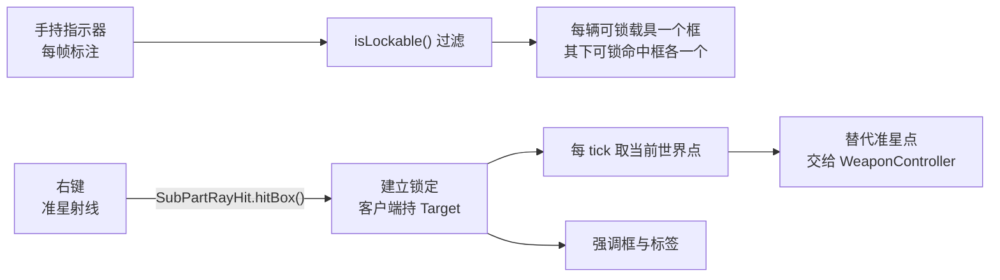

# Machine-Max 武器系统 — 目标粒度与锁定单元 · 设计

> **状态**：进行中。已落地：`Target` 与 `VehicleCore` / `HitBox` 两个实现、`HitBox.isLockable()`、指示器物品与标注层、锁定点接入瞄准上行通道。未落地：传感器接入（`Reading`）、跨端表示与传输（§八）、实体与方向目标。
> **定位**：本文自包含——只读本文即可理解「一个目标是什么、哪些部位能被单独锁定、选定之后由谁持有、怎么交给下游」。
>
> 相邻文档（各自负责自己的主题，本文引用而不复制其内容）：
>
> - `docs/plan/计划中/感知系统-Reading与目标估计设计.md` — 传感器产出的目标信息对象 `Reading`：不可变发布值，带位置、速度、来源、置信度与更新时间；并负责「一条回波拆成几条目标信息」。
> - `docs/plan/进行中/观瞄系统-视点与瞄准控制重构方案.md` — 瞄准输入如何从客户端到达武器控制器。
> - `docs/plan/进行中/武器系统-组件化投射物与类型体系设计.md` — 制导如何消费一个世界点。
> - `docs/plan/进行中/交互-部件精确准星拾取与渲染包围盒设计.md` — 准星如何选中具体碰撞箱。

---

## 一、问题

载具的命中判定精确到碰撞箱：一发炮弹落在哪个 `HitBox`，就按该碰撞箱的材质、厚度与子系统路由伤害。而「目标」在系统里仍是一个世界坐标点——玩家能打中炮管，却无法把炮管作为一个目标**记住、显示、交给制导**。

本文确定三件事：目标用什么类型统一表示、哪些部位能被单独锁定、选定之后由谁持有。

---

## 二、四种单位

| 单位 | 回答的问题 | 载体 |
|---|---|---|
| 航迹 | 场上有几个目标 | `VehicleCore` 的 UUID |
| **可锁定单元** | 能单独选中几个目标 | `Target`，首期由载具与碰撞箱直接实现 |
| 耐久单元 | 有几条血条 | `SubModule`，缺省 `AbstractSubsystem` |
| 命中单元 | 这一发打穿了什么 | `HitBox` |

前两行是多对一：一条载具航迹下可以有多个可锁定单元。

**可锁定单元取 `HitBox`，不取 `SubPart`。** 子部件是刚体，一个子部件对应一套物理代理；要让一个子部件内的若干位置分别可锁，就得把它拆成多个子部件，等于用物理开销换界面粒度。碰撞箱不是刚体，一个子部件内可以有多个，并且已经带有子系统绑定、材质厚度与条件开关。

碰撞箱是内容包数据：定义在 `SubPartAttr.hit_boxes`（位于 `VariantAttr.sub_parts` 之下），随零件实例的 `variant` 持久化在存档里；运行期的 `HitBox` 对象由 `SubPart` 重建。因此「同一个碰撞箱」在一个世界会话内可以被稳定指认，跨存档则需要按名字重新解析。

**框可以多，血条不必多。** 多个碰撞箱指向同一个 `SubModule`（或同一个子系统）时，它们是同一耐久单元上的多个瞄准点：HUD 按 `(零件, 子系统, 模块)` 合并标签与血条，几何上分别画框。这与「每个框一条血条」是两种不同设计，本文取前者。

### 2.1 目标种类

可锁定的东西不止载具与碰撞箱：生物、玩家、箔条与红外诱饵，乃至太阳（早期红外导引头会锁太阳）。它们在类型上统一为 `Target`，由目标自己实现，没有包装类型：

```java
public interface Target {
    Component label();               // 显示名
    Vec3 point(Number partialTick);  // 真值点（世界坐标，米），按 tick 插值
    boolean isLockable();            // 对象侧此刻仍可作为锁定目标
}
```

`point` 带插值系数：目标点是每 tick 更新的，逐帧绘制不带插值会比画面里的载具慢半拍地跳。按 tick 使用的地方传 `1`（当 tick 末）。

`Target` 是名词，回答「它是什么」；`isLockable()` 是状态，回答「此刻还能不能被锁」。两者分开命名，状态判断就不会被读成类型判断。

| 载体 | 身份 | `isLockable()` 的判据 | 交付 |
|---|---|---|---|
| `VehicleCore` | `getAssemblyId()` | 未销毁且已加载 | 首期 |
| `HitBox` | 宿主子部件 + 命中框键 | 内容包声明 `lockable`，且条件激活、模块或子系统存活 | 首期 |
| `Entity`（mixin 实现） | 实体 id | `isAlive() && !isRemoved()` | 后续 |
| `DirectionTarget`（record） | 单位向量 | 恒真，需要时加时段条件 | 后续 |

- 领域对象实现协议接口是本项目既有形态：`VehicleCore` 实现 `IPartAssembly`，`DestroyableObject` 实现 `BFHurtTarget`。
- 传感器报告的目标由 `Reading` 直接携带（`Reading.target`），消费方不需要按位置或 id 反查。
- 原版实体不能声明新接口，用 mixin 补；这是唯一需要跨出领域类的地方。`DirectionTarget` 不是包装——太阳不是对象，方向本身就是它的值。
- 接口保持共通安全：`VehicleCore` 与 `HitBox` 都在 `common/`，`label()` 返回 `Component`，实现里不得引用客户端类。若不想让 `HitBox` 认识显示名，`label()` 可以返回翻译键、由显示层翻译。
- 不封 `sealed`：实现分散在领域类里，封闭名单不成立；消费方不按种类分支，穷尽检查没有收益。

三条约束：

1. **`Target` 表示「可被锁定的对象类别」，不表示「对本传感器可锁」。** 某部传感器锁不上某个目标是传感器的判定，不是目标的属性：flare 对红外可锁、对雷达不可锁，太阳只对早期非制冷红外弹成立。
2. **消费方只调四个方法，不判断种类。** 确实需要种类特化的场景（载具才显示装甲信息）把 `switch` 集中在一处显示层，不允许散在 HUD、制导与 AI 里各判一次。
3. **跨端身份不在目标上解决。** 需要把目标带到另一侧时用 §4.3 的身份键编码，载荷里不放 `Target` 引用；目标对象本身只服务于同侧。

---

## 三、可锁定判定

判定是接口方法，由各载体实现。`HitBox` 的判据是：

```java
@Override
public boolean isLockable() {
    if (!attr.lockable) return false;             // 作者没声明这块值得标
    if (!active) return false;                    // 作者用条件关掉的（打碎的装甲板）
    if (subPart.isRemoved || subPart.isDestroyed()) return false;   // 宿主部件没了
    if (subsystem == null) return false;          // 纯结构碰撞箱，没有功能可破坏
    if (attr.module.isEmpty()) return !subsystem.isDestroyed();
    SubModule m = resolveModule();                // 经 IModularSubsystem#getModule
    return m == null || !m.isDestroyed();
}
```

- **准入是显式的**：`HitBoxAttr.lockable` 缺省 `false`，作者逐块标注哪些部位值得标。碰撞箱数量远多于「有意义的瞄准点」，默认全标会让标注层退化成一片框。
- **声明只是准入，不替代存活判定**：声明了 `lockable` 的框照样要过条件、宿主与耐久单元三关。
- **模块优先于子系统**：炮管打坏后，即使发射器整体还在，炮管那个框也不再是候选。
- `subsystem` 为空的碰撞箱（车体结构板、纯几何）即使声明了 `lockable` 也不进入候选——没有功能可破坏，锁它没有意义。

### 3.1 三个门各归各

| 门 | 判据 | 归属 |
|---|---|---|
| 能否被命中 | `HitBox.active`（Molang `condition`） | 内容包作者 |
| 是否值得标 | `HitBoxAttr.lockable` | 内容包作者 |
| 能否被锁定 | `isLockable()` | 系统默认 |

「打坏了东西还在」的部位（炮管、引擎舱）：`lockable` 写 `true`，命中照常、摧毁后锁定取消。「碎了就该消失」的部位（玻璃、车灯）写 Molang 条件 `!local.subsystem_destroyed('<子系统名>')`：命中与锁定一起消失。

不需要为模块级存活新增 Molang 查询——该判定在 `isLockable()` 内完成，作者不必再写一遍条件。

---

## 四、锁的组成与持有

### 4.1 锁 = 一条测量，或一个裸目标

首期没有传感器，锁定状态就是消费者上的一个 `@Nullable Target`。

传感器接入后，锁定状态就是选中的那条 `Reading`——它的 `target` 就是锁定对象，不需要另存一份；测量过期时用 `target.point(partialTick)` 取真值，锁定因此不会随测量一起消失。

| 状态 | 取点 |
|---|---|
| 手动、光学直瞄（无测量） | `target.point(partialTick)` |
| 测量新鲜 | `reading.posX/Y/Z`，噪声与延迟都在这里 |
| 测量过期、目标仍在 | 外推，或退回 `target.point(partialTick)` |
| 测量的目标为空 | 不建立锁定，只能显示 |

锁定状态不单独建类型：无论是一个 `Target` 还是一条 `Reading`，它都是消费者上的一个字段。

### 4.2 显示用真值，导引用估计

锁定框、标签、血条画在 `target.point(partialTick)` 上；喂给武器控制器的点在有新鲜测量时取该测量的位置。框跟着噪声抖会像渲染错误，制导点抖才是噪声应有的效果。

### 4.3 身份与作用域

| 作用域 | 表示 | 适用 |
|---|---|---|
| 单端单会话 | `Target` 就是活对象本身 | 客户端锁定、HUD、当前瞄准 |
| 会话内跨端 | `(kind, subPartId 或 entityId, hitBoxKey)` | 多人看见同一个锁定框、数据链共享 |
| 跨存档 | `(partUuid, subPartName, hitBoxKey)` | 锁定状态存档 |

- `subPartId` 指 `DestroyableObject.getId()`：进程内自增、随创建同步，会话内两侧一致。
- `hitBoxKey` 指 `SubPart.hitBoxes` 的键，即命中框对应的骨骼名。
- 不使用 `HitBoxAttr.id`：它的语义是「同一 id 的碰撞箱不会被同一次攻击重复命中」，可以重复、可以缺省，适合作伤害分组，不适合作身份。

首期只用第一行。引用不是持久身份——存档重载、变体切换、重新装配都会重建 `SubPart` 与 `HitBox`；引用失效正好等于「该目标不存在了」，不需要额外的失效通知。

### 4.4 服务端不需要知道锁的是哪个框

- 制导需要的是一个世界点，发射器每步把当前点推给投射物（`LauncherSubsystem#setGuidanceTarget` 已是这个形状）。
- 伤害归属由实际命中决定，与玩家锁了哪个框无关。
- 因此锁定可以完全是客户端状态：客户端持有 `Target`，每 tick 算出当前点，经既有瞄准输入通道交给武器控制器。

这条决定了首期不需要新网络包、不需要服务端字段、不需要 `Reading` 同步。

### 4.5 校验与释放

每次使用前校验，不缓存布尔：`isLockable()`、所属子部件仍存活、仍属于同一装配体。

| 触发 | 结果 |
|---|---|
| 手上不再是指示器（切走、丢弃、死亡） | 释放 |
| 目标不再可锁（摧毁或条件关闭） | 释放 |
| 目标子部件或零件被移除、装配体分裂 | 释放 |
| 超出传感器跟踪范围（接入传感器后） | 释放，或转入记忆航迹 |

离座与控制组切换不释放：锁定描述的是「指示器指着谁」，不是「谁在开火」。离座期间没有输出方，重新上座后继续用同一个锁定。

线程：`HitBox.active` 由物理步写入，不是 `volatile`。客户端主线程读到的最多落后一个物理步，只影响框晚一帧消失，不用于判定边界很紧的逻辑。

---

## 五、手动锁定闭环

采集源是玩家手里的指示器物品与准星，不需要任何传感器。



1. **标注**：手持指示器时，视野内每辆可锁载具画一个框，其下每个可锁命中框再各画一个。载具框让人不必逐块找，命中框框出值得单独瞄的部位。
2. **采集**：右键对当前准星命中的碰撞箱建立锁定；命中的部位没有声明 `lockable` 时改为锁整辆载具；射线没打到载具时锁定不变。
3. **保持**：客户端保存 `Target`；对已锁定目标再次右键取消。
4. **输出**：锁定期间把该目标的当前世界点作为瞄准目标交给武器控制器，替换准星给出的点；取消或失效后退回准星。
5. **显示**：锁定目标以不同的颜色与线宽强调。标签取耐久单元的名字：载具取装配体名，命中框写了 `module` 时取 `module`，否则取 `subsystem` 名去命名空间后的部分。

第 4 步复用现有通道：武器控制器与发射器不区分「这个点来自准星还是锁定」。

---

## 六、指示器物品

标注与锁定由一个物品承担，形态是创造栏可取的调试装备，同时是后续手动锁定的正式载体。

### 6.1 行为

| 状态 | 行为 |
|---|---|
| 手持 | 每帧标注视野内的可锁载具，以及其上声明了 `lockable` 的命中框 |
| 右键命中可锁框 | 建立锁定；对已锁定目标再次右键取消 |
| 右键命中载具、但该部位不可锁 | 锁定整辆载具 |
| 右键未命中 | 保持当前锁定不变 |
| 切走、丢弃、死亡 | 释放 |
| 目标不再可锁 | 释放 |

### 6.2 双端分工

- 物品没有服务端逻辑：服务端收到原版右键使用包后直接返回，不写任何状态。
- 共通物品类不引用客户端类，只持一个客户端钩子，由客户端入口注入——与 `PdaItem.setScreenOpener` 同一模式。
- 载具开火走控制组信号，与手持物品无关；手持指示器不妨碍开火。

### 6.3 绘制

- 绘制是一个 GUI 层：在 `RegisterGuiLayersEvent` 里 `registerAboveAll(<id>, layer)` 注册，与 `MMGuiManager.registerHud` 现有的层同一套方式，实现是 `LayeredDraw.Layer`。
- 框是屏幕空间的标记：世界点转像素复用 `ScreenProjectionUtil.worldToScreenOffset`——`SightHud` 已用它把炮镜输入点画成环。传渲染相机、`CameraController.getCurrentFov()`（含炮镜变焦，画面用的就是这个角）与 GUI 尺寸，返回相对屏幕中心的像素偏移；返回 `null` 表示点在相机后方，直接剔除。它不做屏幕外裁剪，出屏的点要自己按 GUI 尺寸判。
- 边长固定 28 像素：不按几何投影，也不随距离缩放。任何随距离变化的写法（含分档）都会跟着距离的每 tick 量化跳变，屏幕上一两像素的呼吸看起来就是抖动；距离本来就由框的位置表达，尺寸只需要保证看清。
- 标记恒与屏幕对齐，因此不随刚体朝向变化，同一子部件的多个框也不会并成一块。
- 粗筛只需要一个点：距离在范围内、投影后落在屏幕内、且从相机到该点的射线不被地形或其他载具打断；操作者所在载具不参与遮挡判定。
- GUI 层没有深度测试，遮挡完全由那条射线负责，漏判就会画出框线。
- 线程：判定读的是同步到客户端的子系统与模块状态；`HitBox.active` 落后一个物理步不影响显示。

### 6.4 组成

| 件 | 落点 |
|---|---|
| 物品注册 | `MMItems.kt` 的 `TARGET_DESIGNATOR`；创造栏条目在 `MMCreativeTabs` 主页 |
| 物品类 | `common/item/prop/TargetDesignatorItem.java`：只持一个客户端钩子，服务端返回 `pass` |
| 客户端状态 | `client/target/TargetDesignatorHandler.java`：持锁、每 tick 候选、右键射线、瞄准点替换 |
| 标注层 | `client/render/gui/hud/TargetDesignatorHud.java`，在 `MMGuiManager.registerHud` 里注册为 `target_designator_hud` |
| 模型与贴图 | `assets/machine_max/models/item/target_designator.json`、`assets/machine_max/textures/item/target_designator.png` |
| 语言键 | `MMLanguageRegistry.ITEM_TARGET_DESIGNATOR` |

### 6.5 为什么不由命令承担

标注是客户端渲染，命令在服务端执行；用命令驱动要额外加一个「设置客户端开关」的载荷，而这条通路不产生任何服务端状态。物品把开关放在玩家手里，不需要协议。

---

## 七、候选与快照

传感器与指示器都需要「附近有哪些可锁目标」。这份候选不能由每个消费者各自扫描：开销是「消费者数 × 载具数 × 碰撞箱数」。

- **载具与碰撞箱进快照**：遍历 `ObjectManager.levelVehicles`，先收可锁载具本身，再收其上声明了 `lockable` 的命中框。载具数量少（每维度几十），这一步最值得共享。快照存的是目标对象本身，每 tick 不产生包装对象；玩家自己乘坐的那辆不入候选。
- **实体不进快照**：实体量大，原版区块索引本身已经做了空间查询，各消费者按自己的 AABB 现查更快，也更容易按视锥裁剪。
- **懒重建**：本 tick 第一次被请求时重建，之后复用到 tick 末。没有消费者时零成本；定时器会在没人用时照样扫。
- **派生值，不是注册表**：每 tick 从 `ObjectManager` 重新计算，不接收目标的增删通知。它因此不可能与真相不一致，也不需要谁记得注销。

快照只负责「有哪些候选」，门限、视场与角分辨率由消费者自己判定。

首期只有指示器一个消费者，候选由 `TargetDesignatorHandler` 每 tick 在自己的列表里重建，不另建共享类型；传感器接入时再把它提升为这里描述的共享派生值。

---

## 八、双端表示与传输

锁定默认留在客户端（§4.4）。需要把目标带到另一侧时——服务端要自己维持锁定、多人共享、锁定存档——按本节编码。

### 8.1 类型与身份分离

```java
public abstract class TargetType<T extends Target> {
    public abstract ResourceLocation id();
    /** 编码身份，不编码整个对象。 */
    public abstract void writeIdentity(RegistryFriendlyByteBuf buf, T target);
    /** 读完身份并在本端世界解析；解析不到返回 null。 */
    public abstract @Nullable T readAndResolve(RegistryFriendlyByteBuf buf, Level level);
}
```

`Target` 只多一个 `type()`。身份长什么样、怎么查回来，全部留在类型定义里；统一入口只做一次泛型擦除：

```java
@SuppressWarnings("unchecked")
public static <T extends Target> void write(TargetType<T> type, RegistryFriendlyByteBuf buf, Target target) {
    buf.writeResourceLocation(type.id());
    type.writeIdentity(buf, (T) target);
}

public static @Nullable Target read(RegistryFriendlyByteBuf buf, Level level) {
    TargetType<?> type = TargetTypes.get(buf.readResourceLocation());
    return type == null ? null : type.readAndResolve(buf, level);
}
```

注册表只登记 `TargetType`，不建目标实例表：对象仍由 `ObjectManager` 与实体表持有，候选由 §七 的快照汇集，锁定在本端直接持有 `Target`。

### 8.2 三种身份

| 类型 | 线上身份 | 作用域与注意 |
|---|---|---|
| 载具 | UUID | 两端一致、可跨会话；`ObjectManager.getVehicle` 在未入表时回退 pending 表，创建包同 tick 内的先后不构成失败 |
| HitBox | `subPartId + boneName` | 会话内；`subPartId` 是进程内自增、客户端靠创建包改写，不能存档；上线前需确认两端相等 |
| 实体 | 会话实体 id | 会话内；客户端只有按 id 的索引，UUID 只用于持久化 |

跨存档用 §4.3 的 `(partUuid, subPartName, hitBoxKey)`。

### 8.3 读取即解析的代价

解析在本端立即发生，四种情况得到空值：载具创建包晚到、目标载具的区块尚未同步给该玩家、实体超出追踪范围或已移除、子部件 id 两端不一致。

首版取**发送端过滤**：只发接收端此刻能解析的目标，服务端→客户端方向按该玩家的区块监视集合判断；接收端拿到空值时丢弃这次锁定并记日志，不缓存身份。

顺序沿用既有纪律：创建包之后紧跟状态补推，锁定包不早于它。

「目标未同步到客户端、但客户端仍要记住它是谁、加载后重新关联」是另一种需求：它要保存身份数据，到那时让类型描述身份键，或让 `Target` 承担可解析表示；现在不铺 `Ref` 类。

### 8.4 协议边界

- 未知类型 id 说明两端类型集合不一致：丢弃整包。身份体长度未知，跳不过去。类型集合变更与项目已有的 `input` / `sync` 版本组一起改，两端的版本号相同才谈得上解析。
- 一条包带多个目标时，每条前加长度前缀；一包一个目标可省。
- 身份从客户端上行时按 `ViewInputPayload` 的口径校验归属、范围与存在性。

### 8.5 实现时机

首期不做：锁定留在客户端，只上行世界点。以下任一项出现时再落地本节——服务端需要自行维持锁定（AI 接管、掉线继续制导）、多人共享同一锁定框、锁定状态存档。

---

## 九、与传感器的接缝

采集源可以替换：准星、指示器物品、未来的传感器 `Reading`。锁定表示与输出不变——传感器只负责给出「哪里有目标、多可信」，不改变「选中之后怎么持有」。

传感器决定的是另一件事：**一条航迹能拆成几个可锁定单元**。这由波段匹配、门限、角分辨率与跟踪容量决定，归 `感知系统-Reading与目标估计设计` 负责，本文只消费其结果。

---

## 十、本设计不做

| 项 | 说明 |
|---|---|
| `Reading` 对象与传感器物理 | 见感知系统文档 |
| `Target` 引用进入网络载荷 | 跨端只传 §4.3 的身份键 |
| `signature` 之类的新内容包字段 | 首期不需要：可锁由 `lockable` 显式声明，传感器波段匹配属于感知系统 |
| 推广 `ModularSubsystem` | 子系统本身就是耐久单元；模块只用于同一子系统内部的进一步区分 |
| 多人共享同一锁定框、锁定状态存档 | 需要 §4.3 第二、三行时才引入 |
| AI 自动选择目标 | 属于感知系统的消费方 |
| 指示器的配方、掉落与耐久 | 首期是创造栏物品 |
| 目标尺寸与角分辨率判定 | 首期没有读取方；传感器的角门限落地时再加，消费者在感知系统 |
| 实体与方向目标 | 等箔条、诱饵与红外弹落地时一起做；那时传感器的波段与门限判定也一并接入 |
| 内容包自定义目标种类 | 出现第二种「既不是载具也不是实体」的目标时，再在子系统上开提供者钩子 |
| `Ref` 类与身份缓存 | 读取即解析；目标未同步时丢弃锁定，不预留待重试的身份 |

---

## 十一、验证要点

- **标注一致**：准星射线命中的碰撞箱，就是该像素附近那个标记框对应的碰撞箱。框以中心为锚，不要求边缘贴合目标轮廓。
- **手持开关**：手持时出现标注，切走后消失；锁定随切走释放。
- **右键语义**：命中可锁框时建立锁定，对同一目标再次右键取消；未命中可锁框时锁定不变。
- **保持**：锁定后移动目标载具，输出的世界点跟随；目标被摧毁后下一 tick 释放。
- **归属不变**：锁 A 框而命中 B 框时，伤害仍按 B 框路由。
- **跨端**：目标子系统被摧毁后，两侧标注同时消失。（属于 §八，尚未落地）
- **无服务端状态**：右键不改变服务端任何数据，除原版使用包外不产生本模组的载荷。
- **合并**：同一子系统的多个碰撞箱产生多个框、一条血条。
- **准入**：没有声明 `lockable` 的碰撞箱，即使绑定了子系统也不出现在标注里；载具框不依赖该字段，始终与其可锁载具一一对应。
- **插值**：载具移动或转向时，标记贴着画面里的部位，不落后半个 tick 抖动。
- **朝向**：载具转向时框的朝向与尺寸都不变，只跟着各自的中心点走。
- **尺寸**：转动视角、走动、换距离时框的边长都恒定，不出现缩放抖动。
- **消费方无种类判断**：HUD 与制导路径不出现对 `Target` 实现类型的判断。
- **性能**：标注开启时，候选收集与遮挡判定只在 tick 里各做一次，渲染帧内只做投影，不把扫描放进每帧路径。
- **自动覆盖**：`mmTargetLock` 固定「纯结构碰撞箱不可锁」与「子系统摧毁后同一命中框退出候选、载具本身仍可锁」两条；其余条目在 runClient 验收。
- **身份等价**：同一碰撞箱在两端解析出的身份相等（会话内 `subPartId + boneName`）。
- **未知类型**：类型 id 不在注册表的载荷被整包丢弃，其后的字节不被解码。
- **解析失败**：目标区块未同步时锁定不建立，且不留下缓存条目。
