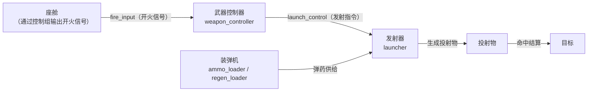

# 3.8 武器系统

武器相关子系统是 MachineMax 在版本迭代中逐步实装的新功能模块。目前已有四种子系统类型（武器控制器、发射器、装弹机和再生装弹机），辅以瞄准镜子系统和数据驱动的投射物系统，构成从目标选择、弹药管理到弹丸出膛与命中结算的完整火力链路。

对玩家来说，武器系统带来的是载具不再只靠碰撞伤人的战斗方式。对内容包作者来说，武器系统引入了一套与动力链并列的新配置维度：弹种设计、弹药供给策略、开火时序和后坐力管理。

> 本章聚焦子系统层面的行为说明。投射物的弹道参数、穿深模型和命中处理流程在内容包 JSON 中定义，第四章的装甲与伤害系统负责结算。投射物系统基于 BallisticsFramework 弹道 API 运行，弹药供给通过 `IAmmoConsumer` / `IAmmoSupplier` 接口在装弹机与发射器之间传递。

## 武器控制链概览

武器系统的四种子系统通过信号和弹药接口协同工作，形成一条两端分别接在"玩家意图"和"目标命中"上的控制链：

其中的关键分工是：武器控制器判断"现在能不能开火、该不该开火"；装弹机负责"有没有弹药、下一份交付是什么"；发射器负责"把弹药变成投射物推出去"；投射物系统负责"飞过去、打中、算伤害"。四者各有边界，信号链路将它们串在一起。

"哪根管由哪台装弹机供弹"由武器控制器在**服务端**单方面决定，再把结果同步给客户端。多管武器因此会逐管摊开——每根管优先落到有余弹、吃得下当前弹种的装弹机上；客户端按同一份指认驱动本机的装填进度、本地交付与音效，两端各自推进同一条作业，tick 收尾统一应用服务端发来的分配变化与结果。

作业收尾时服务端发布一对结果：结束的作业编号与"已交付／未交付"的结论。成功交付、取消、来源失效、暂停超时都走这一条，客户端据此结束身份匹配的本地作业；本机预测出来的弹药内容随之按权威值收口，被撤销的作业不会留下一份多出来的弹。

独占型的装弹机（`can_supply_multiple = false`）同一时刻只服务一条装填作业：机器上记着"哪条作业占着我"的占用记录（消费者 → 作业身份 `(子零件 ID, 发射器名, 作业编号)`），受理那条作业之前指认不算占用，已有别的活跃作业占着的机器直接不进候选，不会出现两根管轮流抢同一台、谁也装不满的情况。摊不开时那根管如实显示无供给者——这是建设不足的信号。换人只有一个目的：让下一份交付更早到手，因此判据是"各自还要多久备好下一份"：已经备好一份的机器报 0 tick，弹仓为空的机器报"给不出"，因此打空的机器会被有现货的候选顶替；没有替代品时绑定保留，等它回充后继续供弹。

受理那条作业时，装弹机同时向它挑中的弹药架取得这一整次作业的**弹药预留**：架上的实际库存先不动，可分配数量（实际库存减去已预留总量）立即减少这次要交的发数。因此多根管共用一架时，第一根管受理后就带走了那一份，其余管看到的是剩余的可分配数量，不会同时开始计时、到点了却抢同一发。作业走完时按它的身份把这笔预留兑现成实际扣减，取消或来源失效则只撤销承诺、不补弹。已取得预留的作业不受其他作业抢走可分配数量的影响，即使可分配数量归零它也会走完。

## 武器控制器：火力指挥中枢

武器控制器（`weapon_controller`）在功能定位上与车辆控制器类似——它不直接产生破坏，而是接收目标坐标和开火信号，协调炮塔驱动、瞄准镜和发射器之间的指令传递。它通常挂载在炮塔座圈或武器站所在的零件上，通过信号系统向发射器下达开火指令，同时根据炮塔当前方位和俯仰角判断射击窗口是否就绪。

对深度玩家来说，武器控制器的存在意味着载具的火力不再只是"右键发射"——射击窗口、炮塔限位和弹种选择都是需要实际操作才能处理的战术要素。对上弹节奏、单发/连发模式、不同弹种的弹道差异等细节的管理，也由武器控制器居中调度。

开火信号与弹种切换指令走同一批频道——座位把主/副武器开火指令分别发到控制组 `main_weapon_targets` / `secondary_weapon_targets` 声明的频道上（内容包里通常是 `fire_input_*`），弹种切换指令也走主武器这一组。武器控制器因此按**信号语义**判定开火，而不是"频道里有没有东西"：主/副武器开火指令、值为 `true` 的布尔、非 0 的数值算开火，弹种切换指令不算。

## 发射器：弹丸出膛的末端执行器

发射器（`launcher`）是武器链的末端——它代表炮闩、导弹挂架、火箭发射管或多管机炮挂点等弹丸投射装置。发射器本身不管理弹药、不判断开火时机；它的职责是从装弹机获取弹药、从武器控制器接收发射指令，然后将弹药以数据驱动的方式生成投射物到世界中。

发射器支持以下关键配置：

- **后坐力吸收比例**：控制开火时后坐力有多少被载具本体吸收、有多少转化为零件位移。高比例的载具在连续射击时车身抖动更明显，但开火感更强；低比例则适合需要稳定瞄准的精密射击平台。
- **投射物类型引用**：通过静态属性指向 JSON 中定义的投射物类型（弹种），决定生成的是高速穿甲弹、低速爆炸弹还是曳光弹等。
- **射速控制**：发射器内建射击间隔，防止在武器控制器发出连续开火信号时以不受控的速率发射。

## 装弹机与再生装弹机：弹药怎么装进武器

武器拿到的弹药单位是一份 **AmmoBelt**：一段有序配弹模式、一个容量、剩余发数与可选的自身回充。模式的条目按书写顺序展开（`AP × 3、AP-T × 1` 表示四发一循环），剩余发数是唯一随消耗变化的计数；打空即耗尽，不因模式可循环而继续发射。模式列表不可变、可以在多处共享，余量与回充进度属于持有它的那一个实例。

交付是**拉取**：发射器请求 → 等供给者备好一份 → 取走整份。供给者不向发射器推送，也不判断发射器收不收。

发射器的静态属性 `single_round_loading` 决定一次拉几发：

- `true`：只把一发推进膛室，不建立已装数据。坦克与自行火炮主炮、导弹发射管、逐发取弹的机关炮用它。
- `false`：把整份 Belt 存为已装数据，射击从这份里取弹。弹链或弹匣整份供弹的机枪、机关炮用它。

拉到交付后发射器再校验：`true` 要求这一份恰好一发；`false` 要求至少一发、且模式里每个弹种炮闩都吃得下，不设整份长度上限。不通过就整份退回当前供给者，等下一次重路由。

### 弹药存储与回收

再生装弹机（`regen_loader`）实例上的 `belt_definition` 是输出模板：每次交付取它的一份副本，一份付一次 `feed.reload_time`。模板的 `length` 是一次交付的发数上限，与源 `magazine.capacity`（源能存多少发）相互独立：库存够一份就交满额，不够就交剩余的全部——交付实例的余量因此可能小于 `length`，模式、长度与标签不变。单发装填的武器把 `length` 填 1。源只记数量、不记弹序；回收按"允许弹种 + 弹仓健康 + 剩余容量"全收或全拒，收下时按剩余发数加回库存。

普通装弹机（`ammo_loader`）的物品弹仓与 `AmmoBelt` 之间的往返映射尚未实现：它的交付与回收明确报告"不可交付 / 拒收"，因此不进入路由候选，也不会有占位物品冒充一次成功交付。

## 再生装弹机：能量武器、街机弹药与双模式再生

再生装弹机（`regen_loader`）以数字库存交付一份份 Belt：它按 `magazine.regen_per_minute` 生产储备，有弹就交给发射器（不必攒满一整份），不需要实体弹药物品。

再生装弹机的静态属性分成两个块：`feed`（输弹机构）与 `magazine`（弹仓）。前者回答"一次输弹付多少时间、允许几根管接"，后者回答"存多少、怎么长回来"。

再生装弹机通过 `magazine.regen_round_by_round` 参数区分两种储备生产策略（这是源自己补货的粒度，与交付粒度无关）：

**随打随产模式（`magazine.regen_round_by_round = true`）**——每消耗一发弹药后立即开始再生这一发，经过 `magazine.regen_per_minute` 定义的速率恢复。适合能量武器（激光电容、等离子炮）：每次射击后电容自动充电，连续发射速度由充电速率决定。每再生一发可从电力网消耗 `magazine.energy_cost_per_round` 能量。

**整弹仓再生模式（`magazine.regen_round_by_round = false`）**——弹仓**完全打空**后才触发再生，经过一段冷却时间后一次性回满至 `magazine.capacity`。适合街机风格武器：例如六联装导弹架全部发射后进入冷却，冷却完成后六枚导弹同时重新生成，期间玩家无需回基地补弹。`magazine.regen_per_minute` 在此模式下的语义为"每分钟可完成多少次完整装填"（整批时长 = 容量 ÷ 速率），总能量成本在回满时一次性扣除。第一方的 PKTM 与 MG34 采用这一模式：打空后整批回满，耗时 10 秒，期间无法射击。

> 整弹仓再生模式的触发点只有一个：**库存归零**。交付不要求满额，库存落在 1 与整份之间时发射器照样把剩下的全部取走，库存随之归零，整批回充随即开始。因此"打空才回满"只是节奏规则：玩家不必特意清空最后几发，余数会被下一次交付带走。

### 交付粒度与顺序

每一份交付付一次 `feed.reload_time`，装几发由发射器的 `single_round_loading` 与源的实际库存共同决定，与供给者类型无关。输弹粒度只有一种，不存在按供给者类型切换的第二种。

单发装填的武器每次拿到长度为一的 Belt（2A90、ATGM、KwK39 的主炮）；整份装填的武器拿到该武器供弹具的发数（由装弹机定义的 `magazine.capacity` 与弹链 `length` 共同决定），源库存不足一份时交付剩余的全部。整份交付把连续供弹切成"打空一份、等补满一份"的循环，持续射速取决于炮闩射速与补满速率中较慢的一方。

### 独占绑定

`feed.can_supply_multiple = false` 是默认形态：一台机器同一时刻最多绑一根活跃管。想让一台机器同时喂多根管时写 `true`，这些管各自计时、各自取弹，库存共同消耗。第一方的 K17 炮塔用共享形态：一台四发导弹装弹机同时喂四根导弹管，每根管各付 10 秒装填时间，共用那 4 发库存，库存按单发 30 秒回充。

再生装弹机使内容包作者可以设计从"缓慢充能的能量炮"到"快速重生的街机导弹"、从"依赖能量网的电容器"到"冷却驱动的免费弹药"等不同手感的武器供给方案。

## 武器链中的信号流

武器系统各组件通过以下信号频道通信：

| 频道名 | 方向 | 说明 |
|--------|------|------|
| `fire_input_p1` | 控制组 → 武器控制器 | 玩家开火意图（来自鼠标左键等按键绑定） |
| `launch_control` | 武器控制器 → 发射器 | 开火许可与弹种选择指令 |
| `ammo_state` | 装弹机 → 武器控制器 | 当前弹药余量、装填进度反馈 |
| `target_coords` | 瞄准镜/炮塔 → 武器控制器 | 目标位置坐标，用于弹道计算和射击窗口判定 |

武器控制器的动态属性定义了输入和输出信号频道，内容包作者需要在零件 JSON 中将这些频道正确串联。例如，炮手座位的控制组预设（`default_gunner`）将鼠标左键绑定到 `fire_input_p1` 频道，武器控制器监听同一频道以接收开火指令。

## 对深度玩家的观察点

- **弹药耗尽是一等威胁**：装弹机弹药打光后，即使武器控制器和发射器完好，载具也失去了火力。长途作战中应关注弹舱余量。
- **后坐力改变瞄准**：连射时后坐力会逐渐改变炮管朝向，需要手动修正或等待炮塔稳定。后坐力吸收比例越高，这种效应越明显。
- **装填节奏决定火力密度**：装填间隔是武器链的瓶颈——提升发射器射速不能超过装弹机的装填速率。
- **再生装弹机的战术取舍**：能量武器在连续发射中可能耗尽储能，需要等待再生。在储能见底的瞬间被敌人逼近是常见死法。

## 对内容包作者的配置指引

### 规划武器链

建议从载具定位出发，反向确定武器配置：

1. 确定载具的战术角色：狙击型（单发大威力）、压制型（连射）、街机型（快速再生弹药）。
2. 选择发射器数量与位置：主炮、副炮、机枪挂点等。
3. 配置对应的装弹机或再生装弹机：决定弹药再生/装填模式。
4. 设置武器控制器与信号链路：确保座舱控制组正确输出开火信号。

### 与信号系统、控制组的配合

武器系统高度依赖信号和控制组——玩家开火不是由"右键"硬编码触发，而是通过控制组中的按键绑定将特定按键映射到 `fire_input` 频道。内容包作者需要在座椅子系统的 `control_group_preset` 中引用合适的控制组预设（如炮手使用 `default_gunner`），或在内容包的 `control_groups/` 目录下自行定义。

关于控制组预设的完整配置格式，见 [5.9 辅助模块](../5-内容包制作教程/5.9-辅助模块.md) 中的控制组预设定义一节。

### 投射物类型的定义

发射器类型通过 `definition` 字段引用投射物类型定义（位于内容包的 `projectiles/` 模块），控制弹道参数（初速、质量、阻力系数、穿深基数等）。投射物系统使用 Structure of Arrays 架构在物理线程中运行，命中后通过 BallisticsFramework 的 `BFDamageApi.hurt()` 进入穿深判定与伤害结算。

---

- 上一节：[3.7 能量系统](3.7-能量系统.md)
- 下一节：[4.1 摩擦与抓地力](../4-物理与战斗机制/4.1-摩擦与抓地力.md)
- 相关参考：[5.9 辅助模块](../5-内容包制作教程/5.9-辅助模块.md) / [5.5 子系统定义](../5-内容包制作教程/5.5-子系统定义.md)
