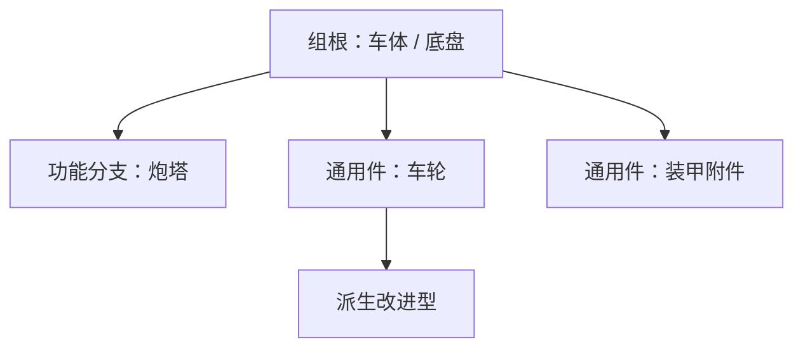

# 5.11 配方设计方法论

[5.8 研发与制造配方](5.8-研发与制造配方.md) 讲的是**怎么写**：字段含义、目录约定、装载期校验。本节讲的是**数值怎么定**：一件零件该消耗多少材料、材料按什么顺序排列、研发阶梯怎么分档。

与之相邻的两套标定是 [4.9 载具与零件耐久标定](../4-物理与战斗机制/4.9-载具与零件耐久标定.md) 与 [4.10 子系统耐久标定](../4-物理与战斗机制/4.10-子系统耐久标定.md)。分工可以用一句话概括：4.9 与 4.10 决定「挨几发才坏」，本节决定「坏了要花多少料、先坏哪一层」。

**本节全部是推荐值，不是硬性规则。** 内容包作者可以按自己的平衡目标覆盖任何一条；覆盖时保持同一包内的单位自洽即可。

## 配方在玩家手里走三条路

同一件零件会被三种不同的方式生产或修复，三条路各有自己的成本口径：

| 环节 | 玩家付出 | 前置门槛 | 设计时关注 |
| --- | --- | --- | --- |
| 制造台（Fabricator） | 配方原料 + 制造时间 | 无研发门禁：配方列表取自全部已加载的制造配方，建任务只校验原料 | `result.count`、`time`、原料总量 |
| 手动装配（焊枪 + 蓝图） | 按 `result.count` 折算后的原料 + 焊接时间 | 研发已完成，或背包里持有该零件的制造蓝图 | 材料清单的**顺序**（见「顺序即层序」一节） |
| 研发（研究台） | 研发点 + 可选研发材料 | 前置项目全部完成 | `research_cost`、`prerequisites`、`research_ingredients` |

这条分工有两个直接后果，值得在动笔前记住：

- **研发点几乎不构成门槛。** 研发点的收入远高于它的支出量级（见「研发阶梯」一节的收入表），几只怪物的经验就够覆盖一次研发。真正决定科技树节奏的是 `prerequisites`（前置）与 `research_ingredients`（研发材料）。
- **制造台不受研发门禁约束。** 只要配方已加载，玩家就能在制造台把它造出来；研发状态影响的是焊枪装配推进与蓝图抄录。把研发设计成「唯一生产方式」时，需要确认该零件没有被别的途径直接产出，不能指望制造台自动封锁。

## 材料单位：六种组件的真实成本

配方原料绝大多数落在这六种组件上。它们都由工作台配方产出，换算成原料后差距很大，因此**不能按个数等权比较**：

| 组件 | 单次合成产出 | 每个折算的原料 | 相对价值 |
| --- | --- | --- | --- |
| 结构件 `structural_component_1` | 4 | 约 1.1 铁锭（含铁栅栏折算）+ 0.25 铜 | **1（基准单位）** |
| 含能材料 `energetic_component_1` | 1 | 1 结构件 + 4 火药 + 4 糖 | 便宜，但受火药产量约束 |
| 电子元件 `electronic_component_1` | 2 | 2 红石 + 1 铜 + 1 金锭 + 0.5 紫水晶 | 中 |
| 机械零件 `mechanic_component_1` | 2 | 1.5 结构件 + 1 活塞 + 0.5 漏斗矿车 + 1 铜 + 0.5 粘液球 | 中高 |
| 武器部件 `weapon_component_1` | 1 | 4 结构件 + 1 发射器 + 2 活塞 + 1 侦测器 | 高 |
| 能源组件 `power_component_1` | 1 | 2 结构件 + 2 铜 + 1 红石 + **4 紫水晶** | 最高（紫水晶是稀缺品） |

设计时把**结构件当作 1 个成本单位**，其余组件按其原料折算取整即可估出整条配方的量级。两条经验约束：

- **能源组件要限流。** 每个都要 4 紫水晶，单车总量建议不超过 6 个；只有真正带发电、储能或电传动设计的零件才用它。
- **武器部件与含能材料只出现在带武器的零件上。** 车体给这两个组件会让「有没有炮」变得没有区别。

## 数值锚点：体量决定结构，结构决定其他

先定体量，再按体量摊到各组件。推荐的三条映射：

1. **结构件 ∝ 装甲与结构质量。** 车体这类大件取「每 0.4~0.6 吨 1 个结构件」的量级；带内部行走机构（负重轮、履带、驱动轮都挂在车体上）的履带车体在此基础上偏高一档。
2. **机械零件 ∝ 传动链与行走机构的数目。** 发动机、变速箱、传动各计 1~2 个；每个独立驱动的车轮计 1 个；履带车的行走机构集中在车体或其他单件上，车轮不计入该件的机械数量。
3. **电子元件 ∝ 观瞄、席位与控制单元。** 每个独立观瞄、每个乘员席位、每套火控或电台各计 1~2 个。炮塔的电子用量通常高于车体，因为观瞄装在炮塔上。

参考官方内容包已经存在的量级（数值取自 `Machine-Max_Official_Pack` 的零件配方）：

| 零件类型 | 结构 | 机械 | 电子 | 能源 | 其他 | `time` |
| --- | ---: | ---: | ---: | ---: | --- | ---: |
| 车轮 | 2 | 1~2 | — | — | 干海带 4 | 35~100 |
| 车门 / 保险杠 / 引擎盖 | 2 | 1 | — | — | — | 50~90 |
| 车壳 | 4~8 | 0~2 | 2~4 | 0~1 | 玻璃板 8~12 | 90~400 |
| 车架（轮式） | 6~24 | 1~6 | 0~4 | 0~6 | — | 45~600 |
| 大型专用件 | 28~64 | 6~16 | 2~32 | 6~24 | 含能 0~6 | 300~800 |

`time` 的单位是 tick（20 tick = 1 秒）。它只影响制造台加工与焊枪推进的手感，不改变材料成本；同一档零件之间保持可比即可，同一包内不要出现「用料是别人三倍、耗时却只有一半」的倒挂。

## 顺序即层序

这是配方设计里最容易被忽略、但对玩法影响最大的一条：**`ingredients` 数组的顺序就是材料层序**。清单开头是核心，清单末尾是最外层。零件受损时，末尾的材料先被销毁。

### 机制

材料清单在加载时被摊平成一份逐份计数的物品表：每个原料按 `ceil(数量 / result.count)` 重复，块与块之间保持 JSON 里的先后关系。之后：

| 行为 | 怎样使用这份表 |
| --- | --- |
| 组装 / 补料 | 从当前材料进度处往后，按表序逐份消耗；缺料时停在该项 |
| 受损丢料 | 材料进度被下调到 `floor(耐久比 × 总数) + 1`，**保留的永远是一段前缀，被销毁的是表尾** |
| 拆卸 / 返还 | 从材料进度往前退，等于从表尾向表头逐份返还 |
| 界面显示 | 材料进度被当作「前 N 项已供」显示，边界处高亮为正在供料的一项 |

设材料总数为 $N$、耐久比为 $r$，受损后保留的份数为

$$
\text{保留份数} = \lfloor r \times N \rfloor + 1 \quad (r > 0)
$$

耐久比降到 0 时保留份数为 0，即材料全部丢失。这里的耐久比取该部件下**各子零件耐久比的最大值**：只要还有一个子零件撑得住，材料就不会继续掉。三条由此推出的结论：

- **表头那一份几乎不会丢。** 只要 $r > 0$，保留份数至少为 1，所以最贵的单件放在清单第一位时，只有零件接近全毁才需要补。
- **表尾那一段最先丢。** 轻伤只会吃掉末尾的少数几份。
- **每层覆盖的耐久区间等于它的份数占比。** 一份材料占 $1/N$ 的耐久带宽，一整个块占「块内份数 / $N$」。

### 排序规则

按「先贵后便宜、先耐久后易碎」排：

```
表头（最内层，最后丢） ──────────────────────────────► 表尾（最外层，最先丢）
能源 → 武器 → 机械 → 电子 → 含能 → 铁块 → 结构件 → 铁锭 → 皮革 / 羊毛 → 玻璃板 / 干海带 / 玻璃
```

- 主判据是**单价**，按上一节的折算表排：越贵的块越靠表头，最贵的块放在末尾等于让它最先被吃掉。
- 次判据是**易碎**：玻璃板（观察窗、潜望镜）与干海带（轮胎）永远放表尾。
- 核心块内部的相对顺序影响很小，可以按可读性微调；**唯一不能违反的是「最贵的块不要在末尾」**。

上一行里除了六种组件，还有四种分散在现有配方中的原料，位置由同一个判据给出：

| 原料 | 出现在 | 位置 | 理由 |
| --- | --- | --- | --- |
| 铁块 `iron_block` | 钢卷 | 含能之后、结构件之前 | 整块的粗钢料，价值高于结构件，但承担的是结构质量 |
| 铁锭 `iron_ingot` | 头灯、扰流板、附加装甲 | 结构件之后 | 螺栓与支架一类的散件，比压制成型的结构件便宜 |
| 皮革与羊毛 | 轮胎胎面、座椅面 | 铁锭之后、玻璃之前 | 软质面料，轻伤即破损，修补只需少量 |
| 玻璃板 / 玻璃 | 车壳观察窗、头灯灯罩、瞄具 | 表尾 | 最易碎，也是最便宜的替换件 |

### 推演示例

假设一件中型履带车体，按上一节定下的用料是：能源 4、机械 10、电子 4、结构 28、玻璃板 2，共 $N = 48$ 份。按规则排列后：

| 材料层 | 份数 | 覆盖的耐久比区间 | 含义 |
| --- | ---: | --- | --- |
| 玻璃板（表尾） | 2 | 96% ~ 100% | 轻伤先碎观察窗，补两块玻璃 |
| 结构件 | 28 | 37% ~ 96% | 装甲板吸收主要伤害，补铁与铜 |
| 能源 / 机械 / 电子（表头） | 18 | 0% ~ 37% | 只有重伤才动到内构 |

也就是说，**近六成的耐久区间由结构件独自承担**，修复代价被压在最便宜的原料上；观瞄与传动要到耐久掉到四成以下才开始丢。若把机械件放在表尾，同样的配方会在耐久掉 2% 时就开始丢活塞与漏斗矿车，修复成本立刻上一个台阶。

### 实现位置

材料清单的摊平与折算在 `PartFabricatingRecipe#deriveManualListsFromIngredients`；装配、拆卸与受损重算在 `Part#assemble`、`Part#disassemble`、`Part#recomputeAssemblyFromDurability`；界面侧的「前 N 项已供」口径在 `AssemblyHud` 与 `AssemblyHud3D#buildMaterialStatus`。

## `result.count` 与堆叠上限

`result.count` 是制造台单次产出的件数，同时充当手动装配的折算分母。它有一条硬约束：

> `result.count` 必须大于 0，且不超过该零件的 `max_stack_size`。零件 JSON 未声明时 `max_stack_size` 默认为 1。

于是有两套可行做法：

| 做法 | 配方 | 零件 JSON | 代价 |
| --- | --- | --- | --- |
| 单件产出 | `result.count: 1`，原料按单件量书写 | 不需要改动 | 八轮车辆要造八次 |
| 批量产出 | `result.count: 2`，原料按批次量书写 | 声明 `max_stack_size`，取值不小于 `result.count` | 需要同时改零件定义 |

现有内容包里两种做法都在用：官方包的轮胎与储物箱走批量（`result.count` 2~4，`max_stack_size` 2~4），车体与炮塔走单件。

批量产出时同样按 `ceil` 与 `floor` 折算，块与块的先后关系不变，因此「顺序即层序」的规则同样适用于批量产出，只是每份材料对应的耐久带宽变细（$N$ 变大）。选批量产出的场合通常只有一种——同一零件需要多件且逐个制造过于繁琐，例如八轮车的车轮。

## 研发阶梯

### 研发点的真实收入

| 来源 | 换算 | 感觉上的量级 |
| --- | --- | --- |
| 获得经验 | 每 1 点经验 = 10 研发点 | 升到 30 级累计约 1400 点经验，约合 14000 研发点 |
| 焊接维修 | 每 10 tick 5 点 | 持续焊接约每秒 10 点 |
| 焊接组装 | 每 10 tick 5 点 | 持续焊接约每秒 10 点 |
| 命中零件 | 每 5 tick 1 点 | 持续交战约每秒 4 点 |
| 造成伤害 | 1 点伤害 = 1 点 | 一发 50 伤害的炮弹约 50 点 |

对照这个收入表，官方内容包里最高的 `research_cost`（600）只相当于几十点经验。因此：

- **`research_cost` 是节奏调料，不是门槛。** 它的正确用法是让不同档位的条目在界面上有轻重之分。
- **阶梯靠 `prerequisites` 与 `research_ingredients` 建立。** 前置决定「先造什么、再造什么」，研发材料决定「必须先有实物」。

### 成本分档建议

| 层级 | 建议 `research_cost` | 说明 |
| --- | ---: | --- |
| 组根（车体、底盘） | 300 ~ 500 | 组的入口，不设前置 |
| 功能分支（炮塔、武器、专用装备） | 250 ~ 450 | 前置为组根；不应高于组根 |
| 通用件（车轮、装甲附件、装饰） | 100 ~ 150 | 前置为组根；同组内最便宜 |
| 派生改进型 | 与基础型同档 | 前置写基础型，形成「基础 → 改进」的链 |

### 前置形状

推荐的树形只有两层，特殊车族再加一层派生：



前置写**完整配方 id**（`machine_max:research/<名字>`），漏掉 `research/` 前缀会让该条目永远不可研发。装载期会校验前置是否存在、是否成环，并把不可达的条目标注为「不可研发」（详见 [5.8](5.8-研发与制造配方.md)）。

### 分组与语言键

- 组没有定义文件，组因被引用而存在；组的显示名取 `<namespace>.<组路径>`，例如组 id `machine_max:my_vehicle` 取语言键 `machine_max.my_vehicle`。
- 条目显示名取 `<namespace>.research.<条目路径>`，例如 `machine_max:research/my_wheel` 取 `machine_max.research.my_wheel`。
- `description` 字段填的是**翻译键**，界面会直接翻译它；键缺失时界面显示键名原文。所以每一条研发条目都要在 `lang/zh_cn.json` 与 `lang/en_us.json` 里备好三个键：组名、条目名、描述。

### `research_ingredients` 的用法

它的语义是「完成研发时必须交出这些物品」，适合表达**迭代**：例如强化型装备要求先交出基础型实物。它不适合替代前置（前置只是条件，不消耗物品），也不适合用来堆数值门槛——真正的量级门槛由原料与制造时间承担。

## 内容包作者检查清单

1. **配方落位正确。** 每个零件都有且只有一条零件配方，文件位于 `recipe/part_fabricating/`，文件名等于零件 id 的 path。
2. **产出数量合法。** `result.count` 不大于该零件的 `max_stack_size`；需要多件产出时已经同步修改零件 JSON。
3. **用料与体量匹配。** 结构件数量落在本节的参考带内，没有出现「小车厢用 64 结构」这类倒挂。
4. **组件只出现在该出现的零件上。** 机械零件只出现在有传动或行走机构的零件上；能源组件单车总量不超过 6；武器部件与含能材料只出现在带武器的零件上。
5. **材料顺序即层序。** 贵重在前、便宜与易碎在后，表尾是玻璃板、干海带这类最外层的脆弱件；最贵的单个原料放在清单第一位。
6. **研发条目齐全。** 每个零件都有对应的研发条目，`unlock_recipe` 指向它的零件配方。
7. **前置成树。** 组根不设前置，其余条目的前置指向组根或更基础的派生型。
8. **语言键齐全。** 组名、条目名、描述三个键在中英两份语言文件里都存在。
9. **时间可比。** `time` 与同档零件可比，没有明显倒挂。
10. **装载期干净。** `./gradlew runServer` 启动后，日志里没有配方目录、零件存在性、重复配方、产物数量、研发前置相关的报错。

## 已知边界

- **制造台不看研发状态。** 配方列表取自全部已加载的制造配方，建任务只校验原料；研发门禁作用在焊枪装配推进与蓝图抄录上。需要「研发后才能获得」的零件，请确认它的成品没有被其他途径直接产出。
- **材料进度只记份数，不记物品。** 顺序决定丢的是哪一段材料；改动 `ingredients` 的数量或顺序，会让在途零件按新的材料总数重新解释。撬棍拆下的零件物品把「缺料份数」记在耐久条上（上限等于组装清单长度），配方改动后旧物品的进度含义也会随之变化。
- **丢失材料会同时压低耐久上限。** 材料进度限制组装进度，组装进度又线性限制该件的耐久上限（不低于原上限的 5%）；因此补料是恢复该件战斗力的必要步骤，不只是数值好看。
- **拆卸按 `floor` 折算会有微量损失。** 拆卸清单取整为 0 的原料不返还，这是设计上的损耗，不要把拆卸当作无损回收（见 [2.3 组装修复](../2-载具系统完全指南/2.3-组装修复.md)）。
- **`manual: false` 的零件没有层序。** 它的装配材料恒为 1 件成品，顺序规则不适用；这类零件的成本全部落在「先造出那件成品」上。
